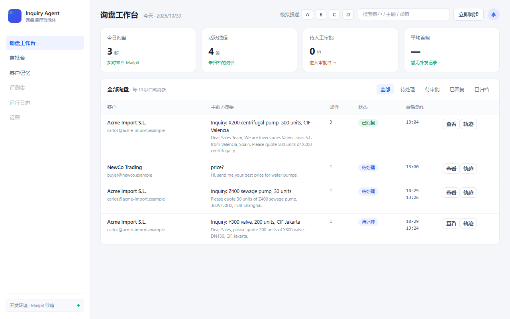
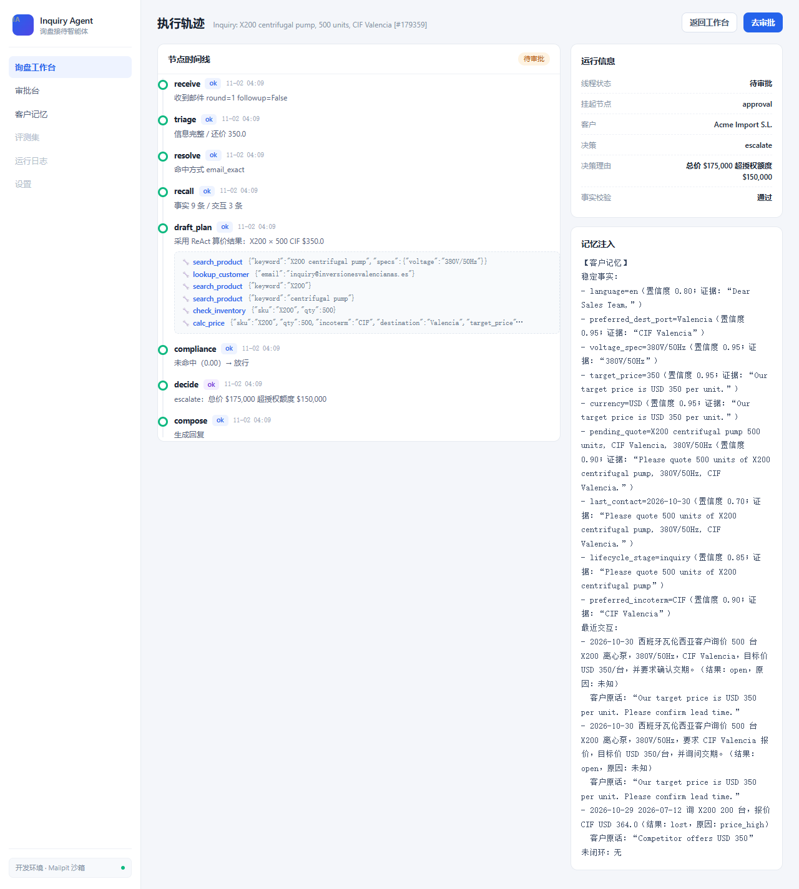
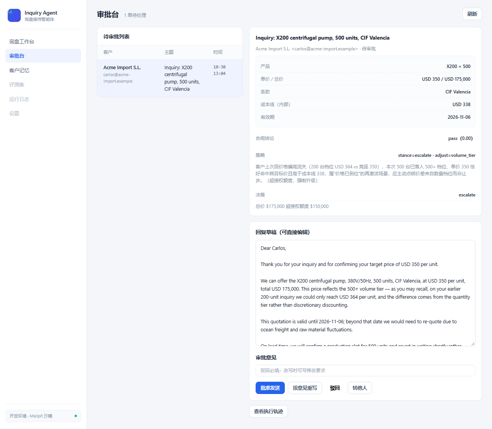
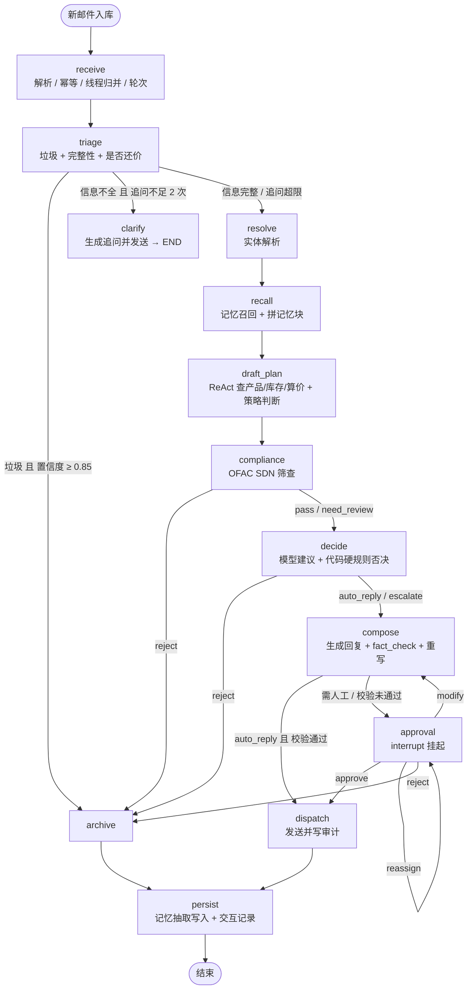
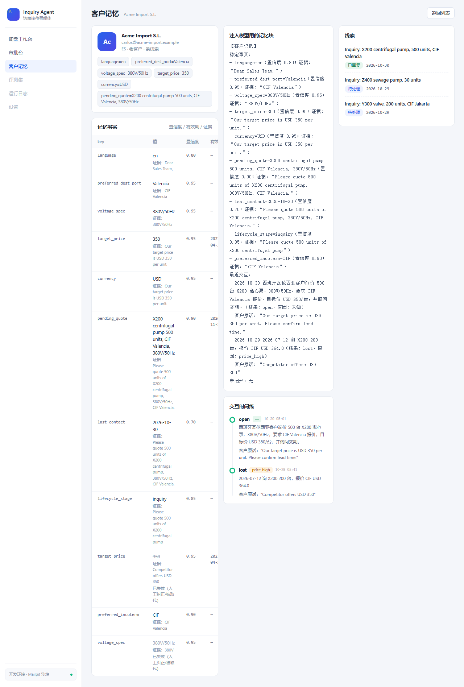
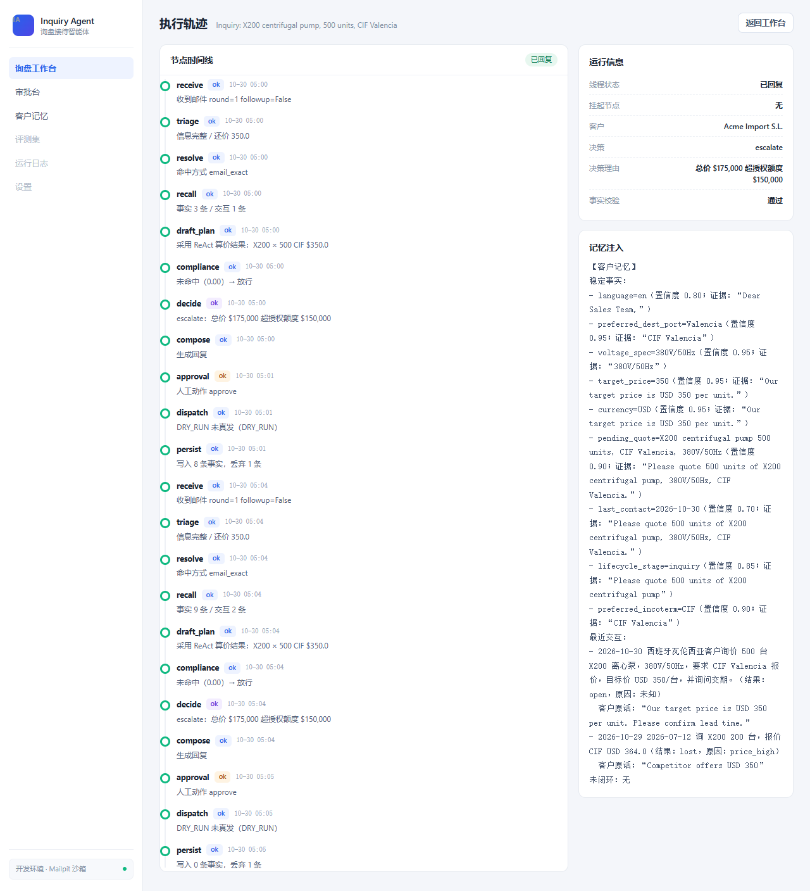

# Inquiry Agent · 外贸询盘接待 Agent

> 一封外贸询盘进来，Agent 自己判断：**该不该回、怎么报价、要不要叫人**。

基于 **LangGraph** 的邮件询盘接待智能体：接信 → 分诊 → 客户识别 → 记忆召回 → 查产品/库存/算价 → OFAC 合规筛查 → 决策 → 生成回复并做事实校验 → 超授权则挂起等人工审批 → 发送 → 沉淀记忆。
全流程 13 个节点、4 个条件分支，状态由 checkpointer 持久化，可在任意一次审批处暂停并跨进程恢复。



---

## 目录

- [它解决什么问题](#它解决什么问题)
- [核心特性](#核心特性)
- [Agent 架构](#agent-架构)
- [关键设计取舍](#关键设计取舍)
- [技术栈](#技术栈)
- [快速开始](#快速开始)
- [模拟演示](#模拟演示)
- [项目结构](#项目结构)
- [API](#api)
- [测试](#测试)
- [配置](#配置)
- [范围与边界](#范围与边界)
- [文档](#文档)

---

## 它解决什么问题

中小外贸企业的询盘有三个现实问题：

1. **慢**：时差导致夜间询盘平均 8—14 小时才回，回复速度直接影响成单率；
2. **碎**：业务员要在一封邮件里同时判断真假需求、查库存、算价、查客户底细、确认合规、写英文回复；
3. **断层**：客户偏好、历史报价、上次为什么没成交，全在业务员脑子里，人一换就没了。

这个项目把这条链路做成一个可观测、可干预的 Agent 工作流：业务员只处理「需要人拍板」的那一小部分，其余自动闭环。

它不是模板群发器，也不是关键词自动回复：走哪条路、调哪个工具、要不要提历史、要不要让价，由模型判断；而**金额授权、制裁命中、成本线**这些红线由代码说了算。

## 核心特性

| 能力 | 实现要点 |
|---|---|
| 邮件接入 | Mailpit（开发）/ IMAP（真实邮箱）双 Provider；MIME 解析、附件与 HTML 处理、`Message-ID` 幂等、按 `In-Reply-To`/归一化主题归并线程 |
| 分诊 | 一次 LLM 调用同时给出垃圾判定、信息完整度、是否还价；垃圾归档要求置信度 ≥ 0.85（宁可漏判，不可误杀真询盘） |
| 客户识别 | 四级实体解析（邮箱精确 / 域名 / 公司名模糊 / 新建），支持人工确认与改绑 |
| 客户记忆 | 结论 + 证据双写：证据必须是客户原话子串；价格类事实带有效期（目标价 180 天 / 历史价 90 天 / 未闭环报价 30 天）；冲突用 `superseded_by` 留痕，不物理删除 |
| 报价规划 | ReAct 工具循环（模型自主调 `search_product` → `check_inventory` → `calc_price`），**最终报价一律由代码重算**，只信工具返回值 |
| 合规筛查 | OFAC SDN 真实公开名单（19,484 条）本地加载、别名索引、名称相似度 + 国别加分；阈值内 `need_review`，超阈值 `reject` 直接归档 |
| 回复生成 | 生成 → `fact_check`（金额/百分比/交期必须能在报价单里找到出处）→ 失败带反馈重写一次 → 仍失败则强制走人工 |
| 人工协同 | `interrupt` 挂起审批，支持 **批准 / 改稿 / 驳回 / 转他人**；改稿后必须再过一次事实校验，不通过退回重写 |
| 工具层 | 6 个读工具（产品检索 / 库存 / 算价 / 客户查询 / 合规筛查 / 翻译）+ 2 个写工具（发信已接线，跟进任务为 Phase 2 占位）；写工具不对模型暴露 |
| 可观测 | 每一步写 `trace`（节点、耗时、工具调用、参数）；全量审计日志；前端「执行轨迹」页可回放 |
| 前端工作台 | Vue 3 五页：工作台（含 KPI、模拟投递、捞回）、审批台、客户列表、客户记忆、执行轨迹 |

<p align="center">
  
  
</p>

## Agent 架构

### 状态图



### 四个条件分支

| 分支 | 判断规则 | 去向 |
|---|---|---|
| `after_triage` | 置信度不足的垃圾邮件**不**自动归档；追问最多 2 次，超限转人工处理 | `archive` / `clarify` / `resolve` |
| `after_compliance` | 制裁 `reject` 直接归档；`need_review` 继续走 `decide`，由硬规则升级人工 | `archive` / `decide` |
| `after_decide` | 议价轮（第 2 轮起、客户还价低于本次报价）一律转人工；其余先进生成 | `archive` / `compose` |
| `after_compose` | 只有「模型判自动回复」且「事实校验通过」才直接发送，否则一律送审 | `dispatch` / `approval` |

### 状态与持久化

- `AgentState` 是 TypedDict，字段按节点单向写入（每字段只有一个生产者），`trace`/`errors` 用 `operator.add` 只追加；
- `SqliteSaver` 按 `thread_id` 持久化，进程重启后仍可恢复审批现场；
- `clarify` 与 `approval` 是两种不同的「等待」：
  - `clarify` 发完追问就 `→ END`，客户回信时用同一个 `thread_id` 重新 `invoke`；
  - `approval` 用 `interrupt()` 真挂起，审批动作通过 `Command(resume=...)` 恢复。
- `interrupt` 恢复会**重新执行整个节点**，因此挂起前的操作必须幂等（只改线程状态），审计与改稿放在 `interrupt` 之后。

### 决策分工

| 判断 | 谁来做 |
|---|---|
| 是不是垃圾邮件、信息是否完整 | 模型 |
| 客户是谁 | 代码（实体解析） |
| 价格多少 | 代码（`calc_price` 工具） |
| 给不给折扣、走哪条路 | 模型建议 + **代码硬规则否决** |
| 是否命中制裁名单 | 代码（名单匹配 + 阈值） |
| 金额是否超授权额度 | 代码 |
| 回复怎么写 | 模型（数字受 facts 约束） |

一句话：**模型负责判断和表达，代码负责计算和红线。**

## 关键设计取舍

- **事实与语言分离**：所有金额/交期只能来自工具返回值。`fact_check` 用正则提取回复里的 `$X`、`X%`、`N days`，逐个与报价单、库存交期、报价有效期比对；人工改稿后同样要校验，不允许跳过。
- **记忆要有证据**：`persist` 写库前逐条校验证据是否为邮件正文子串，伪造/推测的事实直接丢弃；`lost_reason=no_response` 时禁止写入任何价格类事实。
- **报价可复现**：即使模型在 ReAct 里自己调过 `calc_price`，只要 SKU 或数量对不上，代码会重新算一遍再采用。
- **宁可误杀与宁可漏判，分场景**：垃圾邮件判定保守（高阈值 + 允许人工捞回）；制裁筛查相反（名单未加载时**不宣称放行**，直接转人工）。
- **写工具不给模型**：`send_message` 只在审批通过后由代码调用；模型可见的只有 6 个读工具。

## 技术栈

| 层 | 选型 |
|---|---|
| Agent 编排 | LangGraph 1.x（StateGraph + SqliteSaver + `interrupt`）、LangChain Core |
| LLM | DeepSeek `deepseek-chat`（OpenAI 兼容协议，可换任意兼容服务） |
| 后端 | FastAPI、SQLAlchemy 2.0、Alembic、Pydantic v2 |
| 数据库 | SQLite（单机演示足够，结构预留多租户字段） |
| 前端 | Vue 3 + TypeScript + Vite + Element Plus |
| 邮件 | Mailpit（开发）/ IMAP + SMTP（真实邮箱） |
| 测试 | pytest（单元 + 集成，含 Mailpit 真发真收） |

## 快速开始

### 0. 前置

- Python 3.11+
- Node.js 18+
- 一个 OpenAI 兼容的 LLM API Key（默认 DeepSeek）
- 可选：Mailpit（本地 SMTP/收件服务器），用于不接真实邮箱的端到端演示

### 1. 启动 Mailpit（可选，开发期推荐）

```bash
# Docker
docker run -d --name mailpit -p 1025:1025 -p 8025:8025 axllent/mailpit

# 或 Windows 脚本
scripts\start-mailpit.cmd
```

Web 收件箱：<http://127.0.0.1:8025>

### 2. 后端

```bash
cd backend
python -m venv .venv
.venv\Scripts\activate          # macOS / Linux: source .venv/bin/activate
pip install -r requirements.txt

copy .env.example .env          # macOS / Linux: cp .env.example .env
# 编辑 .env，至少填 LLM_API_KEY
```

首次运行建议先拉一次 OFAC SDN 名单（约 1.9 万条，入库后合规筛查才有数据；没加载时所有询盘会按「宁可误杀」转人工）：

```bash
# 在仓库根目录执行
python scripts/fetch_sanctions.py --out backend/data/sanctions/ --load
```

启动服务（启动时自动执行 Alembic 迁移、导入名单、开始轮询收件）：

```bash
cd backend
uvicorn app.main:app --reload --host 127.0.0.1 --port 8000
```

健康检查：<http://127.0.0.1:8000/api/health>

### 3. 前端

```bash
cd frontend
npm install
npm run dev
```

打开 <http://127.0.0.1:5173/inbox>。

### 4. 投一封测试询盘

回到仓库根目录：

```bash
python scripts/send_test_mail.py
```

10 秒内（轮询间隔由 `IMAP_POLL_INTERVAL` 控制）出现在工作台；也可以在页面顶部直接点「模拟投递」。

## 模拟演示

无需真实邮箱即可跑通全链路，内置四个场景：

| 场景 | 内容 | 预期路径 |
|---|---|---|
| A | 西班牙客户询价 500 台 X200，目标价 $350，CIF Valencia | 正常报价 → 事实校验 → 总价 $175,000 超授权 → `waiting_approval` |
| B | 垃圾邮件（15 条链接） | 高分垃圾 → `archived_spam` |
| C | 信息不全（只问 "best price for water pumps"） | 生成追问 → `waiting_clarify`，可模拟客户回信 |
| D | 真实 SDN 实体（BANCO NACIONAL DE CUBA） | 合规命中 → `archived_compliance`，可人工捞回 |

页面路径：工作台「模拟投递」→ 执行轨迹看工具调用 → 审批台批准/改稿/驳回 → 客户记忆页核对事实。

<p align="center">
  
  
</p>

## 项目结构

```text
backend/
  app/
    api/            # FastAPI 路由：收件箱 / 线程 / 客户 / 模拟投递 / 指标
    compliance/     # OFAC 名单加载、实体消歧、启动引导
    db/             # SQLAlchemy 模型、会话、Alembic 迁移入口
    graph/          # AgentState、13 个节点、4 个条件分支、图构建、prompts
    llm/            # ChatOpenAI 封装 + structured output 兼容层
    mail/           # MailProvider 抽象、Mailpit / IMAP 实现、MIME 解析、入库
    memory/         # 记忆抽取、证据校验写入、召回与记忆块渲染
    strategy/       # ReplyStrategy 三层约束（契约 / 判断原则 / 硬规则 guard）
    tools/          # 8 个工具（6 读 2 写）+ 注册表
    config.py       # Pydantic Settings（读 backend/.env）
    main.py         # 应用入口 + 邮件轮询
  alembic/          # 数据库迁移
  scripts/          # 演示、诊断、名单下载
  tests/            # 单元 + 集成测试
frontend/           # Vue 3 + Vite + Element Plus
docs/               # PRD、验收清单、联调记录、截图
```

## API

统一响应格式 `{ok, data, code, message}`。

| 方法 | 路径 | 说明 |
|---|---|---|
| GET | `/api/health` | 健康检查、轮询状态、待审批数 |
| GET | `/api/inbox` | 工作台列表（状态过滤、搜索、分页、KPI） |
| POST | `/api/inbox/sync` | 手动同步收件箱 |
| GET | `/api/threads/{id}` | 线程详情（邮件往来） |
| GET | `/api/threads/{id}/trace` | 执行轨迹、报价、策略、合规、决策 |
| POST | `/api/threads/{id}/process` | 手动触发 Agent 处理 |
| POST | `/api/threads/{id}/resume` | 审批恢复：`approve / modify / reject / reassign` |
| POST | `/api/threads/{id}/restore` | 误判捞回（跳过垃圾判定重跑） |
| POST | `/api/threads/{id}/close` | 人工关闭 |
| PATCH | `/api/threads/{id}` | 改绑客户 |
| POST | `/api/threads/{id}/confirm-customer` | 确认/否认实体解析 |
| GET | `/api/customers` · `/api/customers/{id}` · `/api/customers/{id}/memory` | 客户与记忆 |
| PATCH | `/api/customers/{id}/facts/{fact_id}` | 人工纠正记忆事实 |
| POST | `/api/simulate/inbound` · `/api/simulate/reply` | 内置场景投递 / 模拟客户回信 |
| GET | `/api/metrics` | 业务指标 |

## 测试

```bash
cd backend
pytest tests/ -v
```

覆盖 171 个测试函数：分诊、实体解析、记忆写入/召回、算价与工具契约、合规筛查、事实校验、决策硬规则、审批链路、图结构、邮件解析与入库、端到端流程（Mailpit 未启动时集成测试自动跳过）。

重点回归：

```bash
pytest tests/unit/test_fact_check.py tests/unit/test_memory.py tests/unit/test_decide.py -v
pytest tests/integration/test_full_flow.py -v
```

## 配置

复制 `backend/.env.example` 为 `backend/.env`。常用项：

| 变量 | 默认 | 说明 |
|---|---|---|
| `LLM_BASE_URL` / `LLM_MODEL` / `LLM_API_KEY` | DeepSeek | OpenAI 兼容服务 |
| `MAIL_PROVIDER` | `mailpit` | `mailpit` / `imap` |
| `DRY_RUN` | `true` | 只走流程不真发邮件 |
| `SMTP_HOST` / `SMTP_PORT` | `127.0.0.1:1025` | Mailpit SMTP |
| `IMAP_HOST` / `IMAP_PORT` / `IMAP_USER` / `IMAP_PASSWORD` | — | 真实邮箱 |
| `SEND_WHITELIST` | 空 | 非白名单一律不真发 |
| `AUTO_REPLY_LIMIT` | `150000` | 可自动回复的最大总价（USD），超出强制审批 |
| `SPAM_THRESHOLD` | `0.85` | 垃圾自动归档阈值 |
| `SANCTION_REJECT_THRESHOLD` / `SANCTION_REVIEW_THRESHOLD` | `0.95` / `0.75` | 制裁拦截 / 复核阈值 |
| `QUOTE_VALID_DAYS` | `7` | 报价有效期 |

## 范围与边界

这是个人项目，按「没有真实企业数据、用模拟邮件验证」的定位明确裁剪：

- **不做**：内部资信评分、出口管制（BIS/ECCN）、多币种、自动多轮议价、PDF 形式发票、多租户 RBAC；
- 合规只做 **OFAC SDN 真实名单筛查**，代码里没有资信/出口管制的占位实现，工具描述也不会声称能查这两项；
- 演示默认 `DRY_RUN=true` + Mailpit，不接真实客户邮箱；接真实邮箱时建议保持 `SEND_WHITELIST` 限制；
- 单 Agent 模式；多 Agent（Supervisor + Deal + Compliance）是 PRD 里的 Phase 2 设计，未实现。

## 文档

- [产品需求文档（PRD）](docs/PRD.md)：业务背景、功能需求 F1—F11、状态机、ADR、数据模型、里程碑
- [验收清单](docs/验收清单.md)：Phase 1 的 11 项验收，以及记忆系统、策略约束等专项核对结果
- [联调清单](docs/联调清单.md)：真实邮箱联调记录
- [进度记录](docs/PROGRESS.md)：每个模块的交付与自检（历史记录，非使用文档）

## License

个人作品项目，未附带开源许可证；如需引用请先联系作者。
