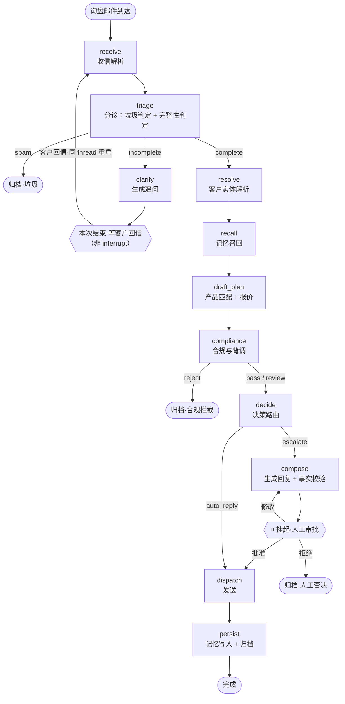
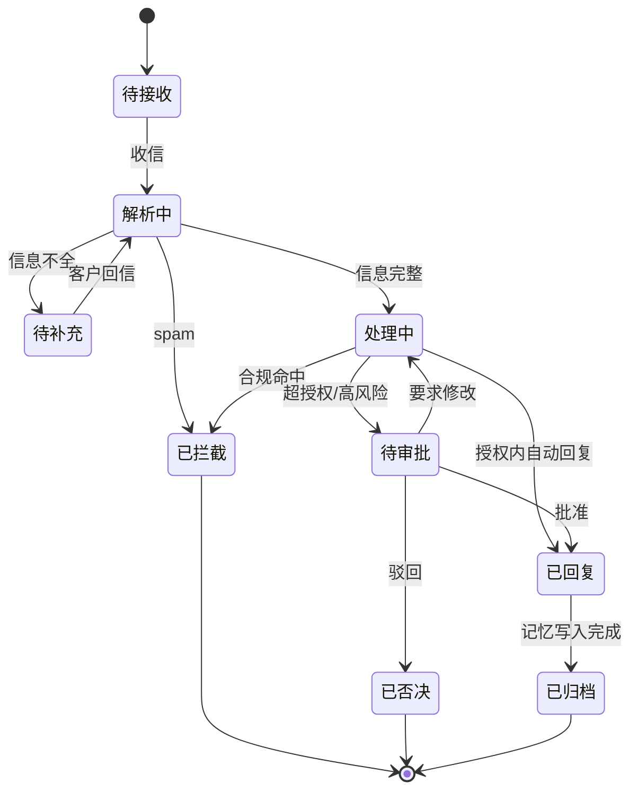
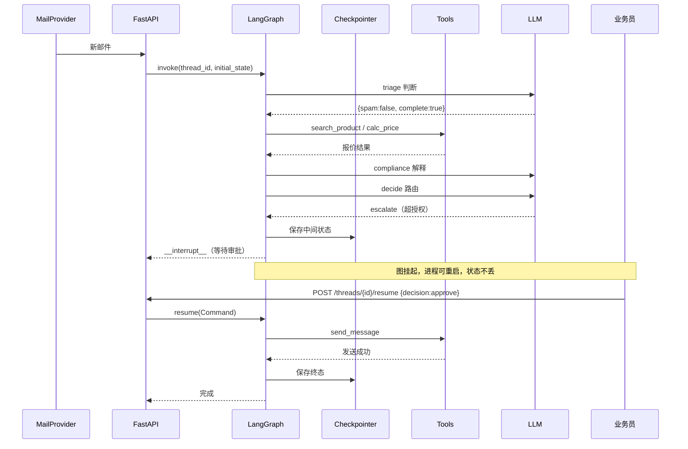
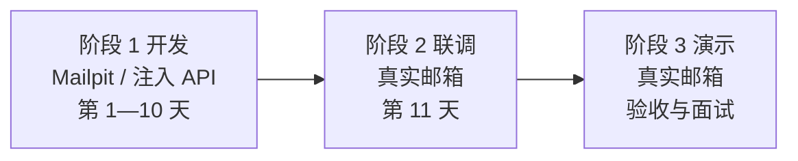
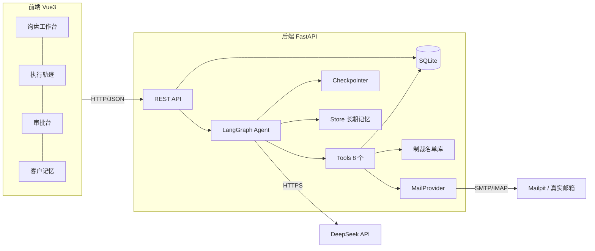
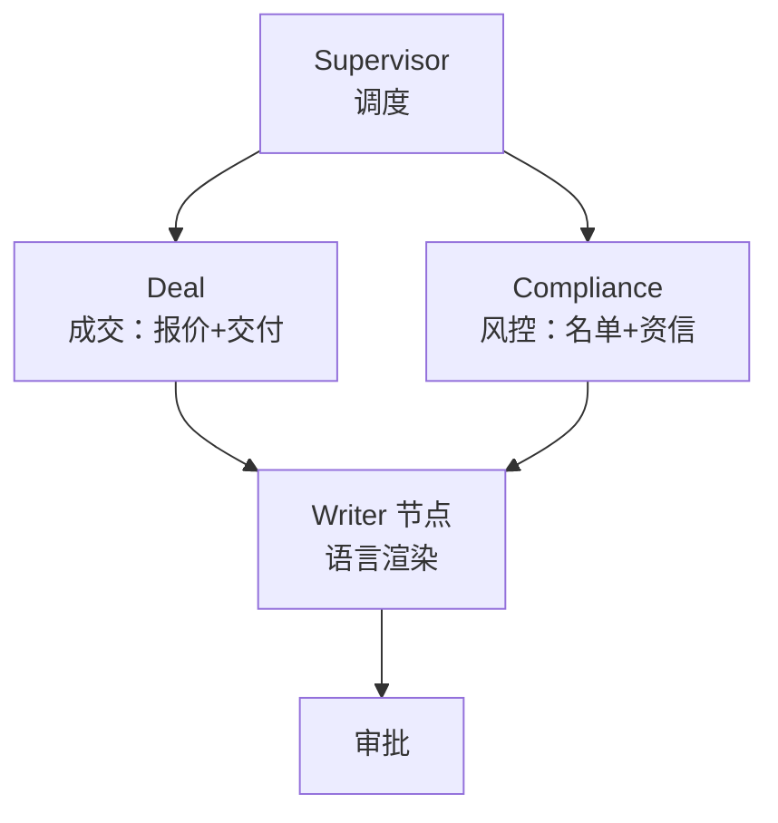
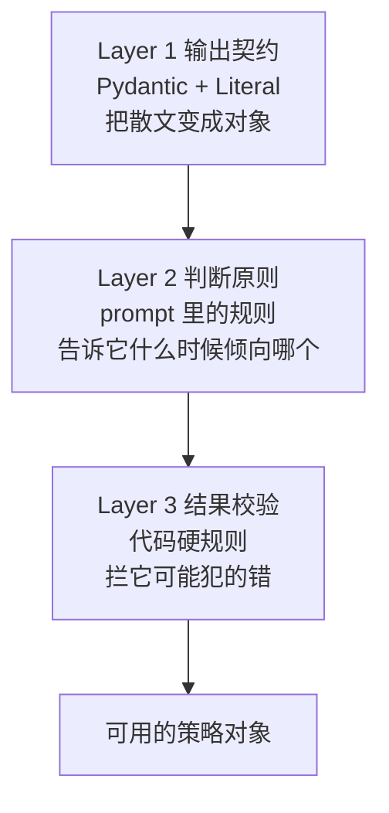
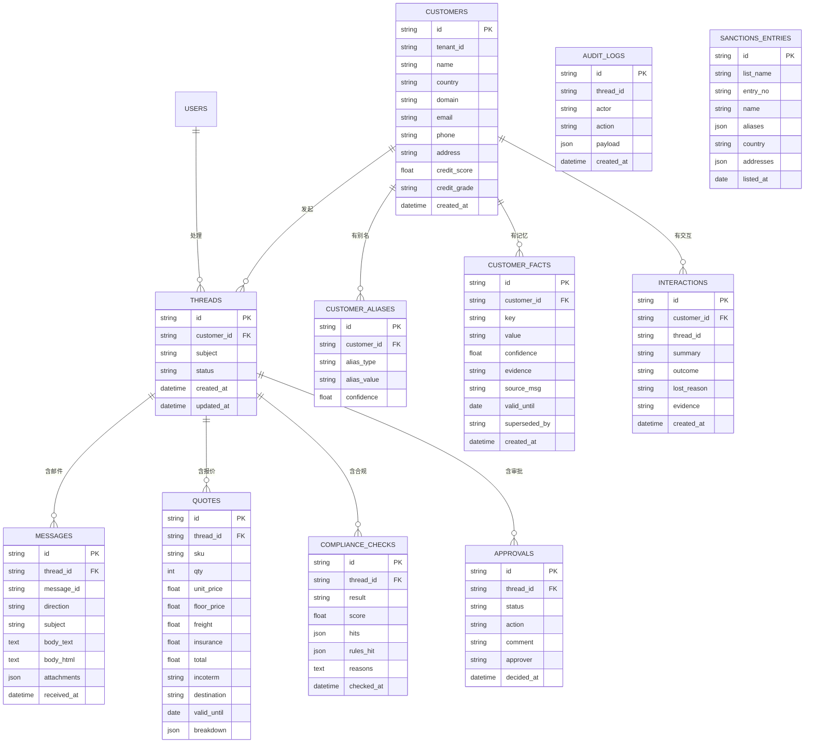

# 外贸询盘 Agent（Inquiry Agent）产品需求文档

| 项 | 内容 |
|---|---|
| 文档版本 | v1.0 |
| 状态 | 已定稿，待实施 |
| 编写日期 | 2026-10-28 |
| 项目代号 | `inquiry-agent` |
| 产品名 | 询盘 Agent / Inquiry Agent（口语名：询盘管家） |
| 一句话定位 | 一个能自己判断、自己查工具、自己决定"回不回、怎么回、要不要叫人"的外贸询盘接待智能体 |

---

## 0. 读者须知（新对话 / 新成员先读这里）

本文档是**唯一权威的需求与设计依据**。任何后续开发对话开始前，按以下顺序阅读：

1. 第 1 章「项目概述」——搞清楚做什么、不做什么
2. 第 2 章「名词解释」——外贸黑话和 Agent 术语
3. 第 7 章「Agent 架构」——核心设计，不能改的东西都在这里
4. **第 5 章 F3「记忆系统」+ 第 7.8「策略判断三层约束」**——最容易写错的两块，细节全在这里
5. 第 12 章「设计决策记录（ADR）」——**为什么这么做，以及不要推翻它的理由**
6. 第 15 章「里程碑」——当前该做哪一步

**写入记忆或修改策略逻辑前，先看第 17.3 的陷阱清单。**

> **📌 要开工请先读 [`docs/START.md`](./START.md)。**
> 本文档回答"做什么、为什么"，START.md 回答"第一条命令敲什么、每天怎么自检"。
> START.md 里还有一段可直接复制给新对话的启动提示词。


**三条硬性约束，任何新对话不得擅自更改**：

- **A.** 决策权交给模型：路由、分类、策略、合规解释由 LLM 决定；金额授权、名单命中、强制转人工由**代码硬规则**决定。不允许把判断逻辑写成 if-else 假装是 Agent。
- **B.** 事实与语言分离：所有数字（价格、交期、运费）只能来自工具返回值，模型只负责组织语言；生成后必须过 `fact_check`。
- **C.** 数据边界诚实：制裁名单用真实公开数据，内部数据用 fixture，付费商业数据用 Provider 接口占位并明确标注，**禁止伪造外部评级**。

---

## 1. 项目概述

### 1.1 业务背景

中小外贸企业的日常形态：

- 客户从官网、阿里国际站、展会、老客户转介绍等渠道发来**询盘（Inquiry）**，一天几封到几十封；
- 业务员要在一封邮件里同时完成：判断真假需求、查库存、算价（含 Incoterm、运费、保险）、查客户底细、确认合规、写英文回复；
- 单封处理 15—40 分钟，时差导致夜间询盘平均 8—14 小时才回，**回复速度直接决定成单率**；
- 老客户的偏好、历史报价、上次为什么没成交，散落在业务员脑子里和邮件历史里，人一换就断层。

### 1.2 产品定义

一个 **Web 端的外贸询盘接待 Agent**：接入企业邮箱，对每封询盘自动完成「识别客户 → 召回记忆 → 判断真伪与完整度 → 查产品算价 → 合规背调 → 决定策略 → 生成回复 → 事实校验 → 超授权则挂起等人工审批 → 发送 → 沉淀记忆」的全链路，全过程可观测、可干预、可追溯。

**它不是**：不是邮件模板群发器，不是关键词自动回复机器人，不是固定的 if-else 流水线。

**它是一个 Agent 的判据**（对应 ADR-01）：

| 判据 | 本项目的体现 |
|---|---|
| 目标驱动 | 目标是"让这封询盘闭环"，不是执行固定步骤 |
| 自主规划 | 由 LLM 决定下一步走哪个节点、调哪个工具、调几次 |
| 循环与条件分支 | 12 节点状态图，4 个条件分支，可回退重试 |
| 反思纠错 | 事实校验失败→重写；信息不全→追问后重入 |
| 状态持久化 | checkpointer 保存任务状态，进程重启可恢复 |
| 人在环 | 2 个 `interrupt` 挂起点：澄清等待、人工审批 |

### 1.3 项目双重定位

| 定位 | 说明 |
|---|---|
| **求职作品**（首要） | 目标岗位 Agent 开发工程师。需要能讲清架构取舍、有可运行 demo、有评测数据 |
| **企业级原型**（次要） | 架构为生产预留扩展点：Provider 抽象、多租户字段、审计日志、可观测性。但首版不追求高可用/高并发 |

### 1.4 非目标（明确不做）

| 不做 | 原因 |
|---|---|
| 多租户 SaaS + 完整 RBAC | 首版单企业单租户，只预留 `tenant_id` 字段 |
| 真实对接邓白氏 / 海关数据 | 付费服务，用 Provider 接口占位 + Mock |
| 站内聊天 / 在线客服 | 只做邮件渠道。WhatsApp/站内信属 Phase 3 |
| 移动端 App | 响应式 Web 即可 |
| 自动议价多轮谈判 | 议价回合**强制转人工**，Agent 只出建议价（C2 决策） |
| PDF 形式发票（PI）生成 | 报价只在邮件正文体现，不生成附件（C4 决策） |
| 多币种 | 首版仅 USD，表结构预留 `currency` 字段（C5 决策） |
| 客户档案自动合并去重 | 只支持单封邮件改绑客户，不做数据治理（见 F2） |
| 大模型本地部署 | 硬件受限，统一走云端 API（见 11.1） |
| 语音 / 电话 | 非本项目范围 |

---

## 2. 名词解释

### 2.1 外贸业务术语

| 术语 | 含义 |
|---|---|
| **询盘（Inquiry）** | 客户发来的采购意向邮件，通常含产品、数量、目的港、交期要求，也可能含糊 |
| **FOB** | Free On Board，装运港船上交货。卖方负责到装船，海运费由买方承担 |
| **CIF** | Cost, Insurance and Freight，成本加保险费加运费。卖方负责运到目的港 |
| **Incoterms** | 国际贸易术语解释通则，规定 FOB/CIF/EXW/DDP 等责任划分 |
| **MOQ** | Minimum Order Quantity，最小起订量 |
| **Lead Time** | 交期，从下单到出货的时间 |
| **阶梯价** | 按数量分档定价，量越大单价越低 |
| **账期** | 付款账期，如 T/T 30 天、60 天，本质是给客户授信 |
| **授权额度** | 业务员可自主报价/放账的上限金额，超过必须上级审批 |
| **背调** | 对客户主体做背景调查：制裁名单、资信、涉敏国家、出口管制 |
| **两用物项** | 军民两用的敏感货物，出口需许可（HS 编码 + ECCN 判定） |
| **老客户** | 系统内已有成交或多次询盘记录的客户主体 |
| **跟进（Follow-up）** | 对已报价但未回复的客户做二次触达 |

### 2.2 Agent 技术术语

| 术语 | 本项目中的含义 |
|---|---|
| **状态图（StateGraph）** | LangGraph 的编排结构，节点=处理步骤，边=流转条件 |
| **checkpointer** | 任务状态持久化，粒度是 `thread_id`，进程重启可续跑 |
| **Store** | 长期记忆，跨 thread 存客户档案，与 checkpointer 职责不同（见 ADR-05） |
| **interrupt** | 图执行到某节点主动挂起，等外部输入（人工审批/客户补充信息）后恢复 |
| **Tool Calling** | 模型输出结构化调用意图，由代码执行真实函数并把结果回灌 |
| **structured output** | 让模型按 Pydantic 模型输出，用 `Literal` 枚举收紧选项 |
| **实体解析（Entity Resolution）** | 判断"这封邮件来自哪个客户主体"，靠邮箱/域名/公司名匹配 |
| **事实校验（fact_check）** | 生成回复后，用代码抽取数字并与工具返回值比对，防幻觉 |
| **轨迹评测** | 不只看最终答案，还检查中间每一步调了哪些工具、是否绕路 |

### 2.3 项目命名约定

| 项 | 值 |
|---|---|
| 仓库名 | `inquiry-agent` |
| 产品名 | 询盘 Agent / Inquiry Agent |
| 后端 Python 包 | `app` |
| 数据库文件 | `backend/data/inquiry.db` |
| LangGraph thread 前缀 | `thread:{mail_message_id}` |

---

## 3. 用户与场景

### 3.1 角色

| 角色 | 职责 | 系统权限 |
|---|---|---|
| **业务员（Sales）** | 处理询盘、报价、跟进 | 查看全部询盘与轨迹；审批**自己权限内**的回复 |
| **业务主管（Manager）** | 处理超授权、复杂客户 | 审批全部；可改报价；可驳回 |
| **管理员（Admin）** | 配置、维护客户主数据、查看审计 | 全部 + 系统配置 |

首版：**只有一个登录账号**（默认 `admin`），角色字段预留，不做权限矩阵校验。见 ADR-09。

### 3.2 核心用户故事

| ID | 用户故事 | 优先级 |
|---|---|---|
| US-01 | 作为业务员，我希望新询盘自动出现在工作台并标好状态，不用手动收信 | P0 |
| US-02 | 作为业务员，我希望 Agent 自动判断是不是垃圾邮件，别让垃圾淹没真询盘 | P0 |
| US-03 | 作为业务员，我希望信息不全时 Agent 自动追问客户，而不是硬着头皮报价 | P0 |
| US-04 | 作为业务员，我希望 Agent 认出这是老客户，并带上他上次的偏好和报价 | P0 |
| US-05 | 作为业务员，我希望 Agent 算价准确，包含运费保险，且不超我的授权额度 | P0 |
| US-06 | 作为业务员，我希望 Agent 做合规筛查，命中制裁名单直接拦下 | P0 |
| US-07 | 作为业务员，我希望超授权的回复挂起等审批，而不是偷偷发出去 | P0 |
| US-08 | 作为主管，我希望审批时看到 Agent 的完整推理依据和风险结论 | P0 |
| US-09 | 作为业务员，我希望看到 Agent 每一步做了什么、为什么这么做 | P1 |
| US-10 | 作为主管，我希望看到客户档案和记忆，知道 Agent 记住了什么 | P1 |
| US-11 | 作为管理员，我希望所有自动发出的邮件都有事实校验记录可查 | P1 |
| US-12 | 作为业务员，我希望 7 天没回的客户自动触发跟进（Phase 2） | P2 |

### 3.3 典型场景（端到端）

**场景 A：老客户二次询盘，超授权**

```
02:17  客户 Acme Import S.L.（西班牙瓦伦西亚，虚构演示客户）发来询盘：
       X200 离心泵 500 台，380V/50Hz，CIF Valencia，问最快交期
02:17  Agent 收信 → 实体解析命中老客户 C-0142（邮箱精确匹配）
02:17  召回记忆：偏好 CIF、账期 60 天、2026-07 询过同款未成交（原因：价格）
02:18  判断：信息完整（产品/数量/参数/贸易术语/目的港都有）
02:18  调工具：search_product → check_inventory → calc_price
02:18  算得 FOB $338 + 海运 $8.50 + 保险 $3.50 = CIF $350/台，合计 $175,000
02:18  合规筛查：OFAC/UN/BIS 无命中；内部资信评分 B（72 分）
02:18  决策：总价 $175,000 超授权 $150,000 → 必须审批
02:19  生成英文回复草稿 + 事实校验通过
02:19  ⏸ 挂起（interrupt），等待人工审批
08:42  业务员上班，看到待审批，核对后批准
08:43  发送
08:45  记忆写入：本次报价事实 + 客户在意价格 → 更新画像
```

**场景 B：垃圾邮件，自动拦截**

```
发件人 no-reply@spam-domain.xyz，正文含 20 个外链、无具体产品、无数量
→ 规则预过滤命中（新域名 + 纯 HTML 广告结构）
→ 模型语义判断：confidence 0.93 为 spam
→ 自动归档，不进入报价流程，不消耗报价工具
```

**场景 C：信息不全，自动追问**

```
客户："Please send me your best price for water pumps."
→ 缺产品型号、数量、目的港
→ 生成追问邮件（问型号、数量、目的港、交期要求）
→ ⏸ 挂起，等客户回复（同一 thread，可续）
→ 客户回信 → 恢复执行，重新判断完整度
```

**场景 D：合规命中，直接拒绝**

```
客户主体命中 OFAC SDN 名单（相似度 0.97，国别一致，地址匹配）
→ Compliance 硬规则判定 reject
→ 不生成报价，生成礼貌拒绝/转法务提示
→ 状态：已归档·合规拦截，记录命中条目编号与置信度
```

---

## 4. 整体业务流程

### 4.1 主流程图



### 4.2 状态机



### 4.3 时序图（含 interrupt 挂起恢复）



---

## 5. 功能需求

### F1 邮件接入与解析（P0）

| 项 | 要求 |
|---|---|
| 支持协议 | IMAP 收信 + SMTP 发信 |
| **开发模式** | **Mailpit 原生 exe（已选定，v1.32.0 已装并验证）**，Docker 为备选 |
| **真实邮箱模式** | 真实邮箱 + 授权码（QQ / 163 / 企业邮 / Gmail），**最终演示必须走这条** |
| 抽象 | `MailProvider` 接口，两套实现，`.env` 切换 |
| 解析内容 | 发件人、收件人、主题、纯文本正文、HTML 正文、附件列表、`Message-ID`、`In-Reply-To`、`References` |
| 线程归并 | 优先用 `In-Reply-To` / `References` 归到同一 thread；缺失时用主题归一化（去 Re:/Fwd:）+ 发件人 |
| 幂等 | 以 `Message-ID` 为唯一键，重复拉取不重复处理 |
| 编码 | 处理 MIME、Base64、Quoted-Printable、多编码混排 |

#### F1.1 三阶段接入策略（必须按这个顺序）



| 阶段 | 用哪个 | 目的 | 什么时候 |
|---|---|---|---|
| **开发期** | Mailpit 或 `POST /api/simulate/inbound` | 快速迭代，不碰真实邮件 | 第 1—10 天 |
| **联调期** | **真实邮箱 IMAP/SMTP** | 证明能对接真实邮件系统 | **第 11 天（必做）** |
| **演示期** | **真实邮箱**（Mailpit 作降级备份） | 现场收发真实邮件 | 验收 / 面试 |

> **⚠️ 这一条不能省。** Mailpit 只是本地模拟，它能跑通不代表能对接真实邮箱。IMAP 的编码、附件、超时、限流、SSL 都与本地不同，必须用真实邮箱验证一次，否则演示当天才发现问题就来不及了。

#### F1.2 真实邮箱配置参数

| 服务商 | IMAP | SMTP | 备注 |
|---|---|---|---|
| QQ 邮箱 | `imap.qq.com` : 993 (SSL) | `smtp.qq.com` : 465 (SSL) | 需开启 IMAP/SMTP 并生成授权码 |
| 163 邮箱 | `imap.163.com` : 993 (SSL) | `smtp.163.com` : 465 (SSL) | 同上 |
| 腾讯企业邮 | `imap.exmail.qq.com` : 993 | `smtp.exmail.qq.com` : 465 | 可能需要管理员开权限 |
| Gmail | `imap.gmail.com` : 993 | `smtp.gmail.com` : 587 (STARTTLS) | 需开启两步验证 + 应用专用密码 |

> 以服务商官方文档为准，上表是常见默认值。

**授权码获取（以 QQ / 163 为例）**：

1. 登录网页版邮箱 → 设置 → 账户
2. 找到「POP3/IMAP/SMTP 服务」→ 开启 IMAP/SMTP 服务
3. 按提示验证后**生成授权码**（一串随机字符）
4. 这个授权码就是 `.env` 里的 `IMAP_PASSWORD` / `SMTP_PASSWORD`，**不是邮箱登录密码**

#### F1.3 联调验证清单（8 项，全过才算接通）

| # | 验证项 | 怎么验 |
|---|---|---|
| 1 | **收信** | 用另一个邮箱给测试邮箱发一封，10 秒内出现在工作台 |
| 2 | **解析** | 主题、正文、发件人、`Message-ID` 全部正确 |
| 3 | **线程归并** | 在邮件客户端里点"回复"，确认新邮件归到同一 thread |
| 4 | **发信** | Agent 回复后，在真实邮箱客户端里能收到 |
| 5 | **会话串联** | 发出的回复在客户端里能串成同一对话（`In-Reply-To` / `References` 正确） |
| 6 | **幂等** | 同一封邮件被拉取两次，不重复建 thread |
| 7 | **编码** | 中文主题、中文正文、带附件邮件都不乱码 |
| 8 | **反垃圾** | 发出的邮件没进对方垃圾箱（个人邮箱难做 SPF/DKIM，此项可接受"偶发"） |

#### F1.4 安全约束（避免误发真邮件）

| 约束 | 说明 |
|---|---|
| **必须用专用测试邮箱** | 不要用工作邮箱，不要用会收到真实客户的邮箱 |
| 联调时收件人是自己 | 只给自己控制的另一个邮箱发 |
| `DRY_RUN=true` 默认开启 | 只生成不发送；联调验证第 4 项时才临时关闭 |
| 白名单 | `.env` 配 `SEND_WHITELIST=自己的邮箱`，非白名单地址一律不真发 |
| 审计 | 每次真实发送写 `audit_logs`，含收件人、时间、`Message-ID` |

#### F1.5 演示风险与预案

| 风险 | 预案 |
|---|---|
| 现场网络不稳 | **保留 Mailpit 作为降级方案**，`.env` 切 `MAIL_PROVIDER=mailpit` 即可继续演示 |
| 邮箱服务商限流 | IMAP 轮询间隔 ≥ 30 秒，不要高频拉取 |
| 发出的邮件进垃圾箱 | 提前 1 天测试；演示时优先用 QQ/163 这类收信宽松的邮箱 |
| 演示中误发给真实客户 | 白名单机制 + 演示前检查 `SEND_WHITELIST` |
| 完全失败 | **提前录一段完整流程的录屏**，作为最后兜底 |

**验收**：Mailpit 或真实邮箱投递一封含 HTML 和附件的邮件，能在 10 秒内出现在工作台，字段解析正确；**且真实邮箱模式下 8 项联调全部通过**。


### F2 客户实体解析（P0）

四级匹配，命中即返回，置信度递减：

| 级别 | 匹配方式 | 置信度 | 后续动作 |
|---|---|---|---|
| L1 | 发件邮箱精确匹配 `customers.email` | 1.0 | 直接采用 |
| L2 | 域名匹配（同公司不同人） | 0.85 | 直接采用，记录方法 |
| L3 | 公司名模糊匹配（编辑距离 + 向量相似 > 0.9） | 0.70 | **需人工确认**后才采用 |
| L4 | 正文签名中抽取公司名 / 电话匹配 | 0.60 | **需人工确认** |
| 兜底 | 都未命中 | — | 新建客户档案，标记 `is_new=true` |

**必须处理的三个坑**：

- 客户换邮箱 → L2/L3 兜底，不能建成新客户
- 多个客户共用代理邮箱 → L1 命中但公司名不符时，降级到 L3 并要求确认
- 个人邮箱（gmail/outlook）→ 域名无信息，只走 L3/L4

**产出**：`Resolved{ customer_id, method, confidence, need_confirm }`。

**误判纠正流程（必须实现，否则认错客户后无法挽回）**：

| 场景 | 处理 |
|---|---|
| L3/L4 命中且 `need_confirm=true` | **不自动采用**。thread 状态置 `pending_confirm`，工作台标黄提示；业务员在详情页点"确认是这家 / 不是这家" |
| 确认为"不是" | 新建客户档案，并把该邮箱加入新客户的 `customer_aliases`，同时从旧客户别名里移除 |
| 事后发现认错了 | 客户详情页提供"改绑客户"操作：`PATCH /api/threads/{id}` `{customer_id: 新ID}`；同步修正该 thread 的 `interactions` 归属 |
| 两个客户被合并成一个 | 客户详情页提供"拆分"提示，但**首版只做人工改绑，不自动合并/拆分** |

> **首版范围明确**：支持"这一封邮件改绑客户"，不支持"两个客户档案自动合并去重"。后者是数据治理问题，不在 MVP 内。

**API 补充**：

| 方法 | 路径 | 说明 |
|---|---|---|
| POST | `/api/threads/{id}/confirm-customer` | `{customer_id, is_correct}` 确认或否认实体解析结果 |
| PATCH | `/api/threads/{id}` | `{customer_id}` 人工改绑客户 |

**客户数据从哪来（C3 决策）**：

| 来源 | 说明 |
|---|---|
| **预置演示客户** | 种子脚本写入 3—5 个虚构客户（含别名、历史订单、记忆事实），用于演示老客户场景 |
| **自动建档** | L1—L4 全部未命中时，`resolve` 节点自动创建新客户档案（`is_new=true`），后续由人工补全公司信息 |
| **不做** | Excel 批量导入、CRM 对接（非 MVP 范围） |

**预置演示客户清单**（`backend/app/db/seed.py`）：

| 客户 | 邮箱 | 画像 |
|---|---|---|
| Acme Import S.L.（西班牙） | `acme-import.example` | 老客户，8 年，偏好 CIF，2026-07 询 X200 未成（price_high） |
| NewCo Trading（德国） | `buyer@newco.example` | 新客户，无历史 |
| Sanctioned Trading（虚构受制裁方） | `trading@sanctioned-example.com` | 用于验证合规拦截 |


### F3 记忆系统（P0）

> **核心认知：模型本身没有记忆。** 所谓长期记忆，是代码在每次调用模型前，把数据库里相关记录查出来、拼成一段文字塞进 prompt。模型每次都是"第一次见这个客户"，只是手里拿着一份档案。
>
> 因此记忆系统的本质是：**写的时候抽结论，读的时候拼档案**。模型只负责"读档案做判断、写语言"，不负责"记住"。

#### F3.1 三层存储，职责严格区分（ADR-05）

| 层 | 存储 | 生命周期 | 内容 |
|---|---|---|---|
| 短期记忆 | `state["messages"]` | 单次图执行 | 本次对话上下文 |
| 任务状态 | LangGraph checkpointer（SQLite） | 跨进程、跨天 | 节点位置、已出报价、待审批内容 |
| 长期记忆 | 业务表 `customer_facts` + `interactions` | 永久 | 客户画像、偏好、历史结论 |

**常见错误**：把客户记忆塞进 checkpointer。后果是记忆绑在 thread 上，客户换个邮件主题就丢了，且无法按客户维度检索。**记忆必须挂在 `customer_id` 上，不是 `thread_id`。**

#### F3.2 三种记忆类型

| 类型 | 存什么 | 表 | 例子 |
|---|---|---|---|
| **陈述型**（Semantic） | 稳定事实 | `customer_facts` | 380V/50Hz、偏好 CIF、要 CE 认证 |
| **情节型**（Episodic） | 某次发生了什么 | `interactions` | 2026-07-12 询 X200 200 台，报 CIF $364，未成交 |
| **程序型**（Procedural） | 怎么跟这人打交道 | `customer_facts` | 喜欢简短邮件、习惯砍价 10%、决策人是老板 |

#### F3.3 长期记忆五步

1. **存储设计**：`customer_facts(customer_id, key, value, confidence, valid_until, evidence, source_msg, superseded_by, created_at)`
2. **写入时机**：任务闭环后（`persist` 节点）。**不在对话中途写**——中途状态是半成品，客户还没表态，写了就是噪声
3. **抽取方式**：LLM 结构化抽取（`with_structured_output`），输出**结论 + 证据**，不存原始对话
4. **召回方式**：按 `customer_id` 查 `未过期事实` + `最近 3 次交互摘要` + `未闭环 thread（pending）`，拼成记忆块注入 prompt
5. **更新与遗忘**：价格类事实必须带 `valid_until`；冲突时保留新旧两条并标记 `superseded_by`；支持按客户 ID 全量删除（GDPR 式）

   **冲突取值规则（必须写死，不能让实现者自己猜）**：

   | 情况 | 召回时取哪条 |
   |---|---|
   | 同 key 多条有效记录 | 取 `superseded_by IS NULL` 且 `created_at` 最新的一条 |
   | 旧记录已标 `superseded_by` | 永不召回（但保留供审计） |
   | 新记录 `confidence` 明显低于旧记录（差值 > 0.3） | 两条都给模型，标注置信度，让模型自己权衡 |
   | `valid_until < today` | 永不召回 |

   写入时的冲突处理：新值覆盖旧值时，把旧记录 `superseded_by` 指到新记录 ID，**不删除**。


#### F3.4 证据校验（**硬规则，不可省略**）

抽取出的每个结论**必须附带客户原话片段**，且该片段必须真实存在于邮件原文中，否则整条丢弃。

```python
def validate_and_write(extract, mail_body: str):
    for f in extract.facts:
        # 有结论必须有证据
        if not f.evidence.strip():
            log.warning(f"无证据，丢弃: {f.key}")
            continue
        # 证据必须是原文子串（归一化后比对）
        if normalize(f.evidence) not in normalize(mail_body):
            log.warning(f"证据不在原文，疑似编造，丢弃: {f.key}")
            continue
        db.upsert_fact(...)
```

**为什么必须做**：模型会把"客户的意图总结"当成"客户说过的话"。不校验的话，记忆里会积累伪造证据，后续所有判断都建立在假前提上——**比不记更糟**。

#### F3.5 `lost_reason` 必须区分「嫌贵」和「没回」

这是**利润率杀手级**的设计细节，必须写进代码：

| 情况 | `lost_reason` | 证据 | 下次策略 |
|---|---|---|---|
| 客户明说 "too expensive" / "above our budget" | `price_high` | 客户原话 | 可以给量价方案 |
| 客户给出对标价 "competitor offers $350" | `price_high` | 客户原话 | 对齐目标价 |
| 客户说 "lead time too long" | `lead_time` | 客户原话 | 改交期或说明 |
| **报价后客户不回信** | **`no_response`** | **空** | **禁止直接降价**，应主动询问上次顾虑 |
| 信息不足无法判断 | `unknown` | 空 | 不做价格假设 |

**反例（必须避免）**：`客户没回 → 归因嫌贵 → 主动降价`。客户不回可能是项目延期、在比价、邮件进垃圾箱、在等他自己的客户。把 `no_response` 当 `price_high` 处理，Agent 会持续让利，直接侵蚀毛利。

#### F3.6 `fact key` 完整清单

| key | 类型 | 置信度默认 | 有效期 | 来源 |
|---|---|---|---|---|
| `contact_name` | 陈述 | 0.95 | 永久 | 邮件签名 |
| `decision_maker` | 陈述 | 0.70 | 永久 | 推断，需人工确认 |
| `language` | 陈述 | 0.90 | 永久 | 邮件语种 |
| `timezone` | 陈述 | 0.90 | 永久 | 国家/城市 |
| `preferred_incoterm` | 陈述 | 0.90 | 永久 | 询盘内容 |
| `preferred_dest_port` | 陈述 | 0.95 | 永久 | 询盘内容 |
| `payment_terms` | 陈述 | 0.85 | 永久 | 谈判结果 |
| `currency` | 陈述 | 0.90 | 永久 | 询盘内容 |
| `packaging_req` | 陈述 | 0.85 | 永久 | 客户明确要求 |
| `certification_req` | 陈述 | 0.90 | 永久 | 客户明确要求 |
| `voltage_spec` | 陈述 | 0.95 | 永久 | 询盘内容 |
| `frequency_spec` | 陈述 | 0.95 | 永久 | 询盘内容 |
| `target_price` | 情节 | 0.85 | **180 天** | 客户原话 |
| `historic_price` | 情节 | 0.95 | **90 天** | 我方报价记录 |
| `lost_reason` | 情节 | 0.85 | **180 天** | 客户原话 |
| `bargain_style` | 程序 | 0.70 | 永久 | 多次交互归纳 |
| `payment_punctuality` | 陈述 | 0.90 | 永久 | 内部订单记录 |
| `pending_quote` | 情节 | 1.00 | **跟随报价有效期** | 报价记录 |
| `last_contact` | 陈述 | 1.00 | 永久 | 邮件时间戳 |
| `lifecycle_stage` | 陈述 | 0.80 | 永久 | 规则计算（new/active/dormant/lost） |

**有效期规则**：价格类（`target_price` / `historic_price`）必须过期，否则半年后还被拿来当谈判依据；规格类（电压、认证）永久有效。

#### F3.7 什么该记，什么不该记

判断标准一句话：**下次询盘还用得上吗？**

| 信息 | 记？ | 理由 |
|---|---|---|
| 380V/50Hz | ✅ | 稳定，每次选型都影响 |
| 本次要 500 台 | ❌ | 一次性，下次数量不同 |
| 本次要 11 月前到货 | ⚠️ 记进 `interactions` | 是事件不是属性 |
| 偏好 CIF | ✅ | 稳定偏好 |
| 上次报价 $350 | ✅ 带有效期 | 谈判筹码 |
| 客户喜欢简短邮件 | ✅ | 程序型记忆 |
| 客户在西班牙 Valencia | ✅ | 时区/运费/语言都依赖 |
| 本次邮件用了 "urgent" | ❌ | 一次性情绪词，记了是噪声 |

#### F3.8 记忆的消费方（记忆不是给一个节点用的）

| 记忆类别 | 消费节点 | 产生什么效果 |
|---|---|---|
| 公司别名 / 关联邮箱 | `resolve` | 客户换邮箱也认得出 |
| 语言偏好 | `compose` | 自动切西语 / 英语 |
| 时区 | `dispatch` | 在他的工作时间发 |
| 常用术语 / 目的港 | `draft_plan` + `triage` | **默认 CIF Valencia，不用再问** |
| 电压 / 认证规格 | `search_product` | 直接匹配 380V，不推 440V |
| 历史成交价 / 目标价 | `draft_plan` | 判断本次报价是否偏离 |
| 付款准时率 | `compliance` | 内部资信打分 |
| `pending_quote` | `decide` | **避免重复报价** |
| 沉默天数 | `followup`（Phase 2） | 7 天未回自动触发 |
| 沟通风格 | `compose` | 长邮件还是三句话 |

> **记忆最核心的价值不是"个性化"，而是"不用重复问、不用重复报、不用重复解释"。** 老客户第二次询盘时，Agent 应当少问 3—4 个问题。

#### F3.9 记忆块注入示例

```
【客户记忆】Acme Import S.L.（西班牙 Valencia，联系人 David García，采购经理）

历史：
  2026-07-12 询 X200 200 台，报 CIF USD 364，总 USD 72,800
  2026-07-15 客户还价：目标价 USD 350 CIF，并暗示可加量
  结果：未成交，原因 price_high（置信度 0.85）

客户原话：「USD 364 is above our budget」
客户原话：「a competing offer at USD 350 CIF Valencia」
客户原话：「If you can match USD 350, we can consider a larger order」

稳定偏好：380V/50Hz、CE 认证、CIF Valencia、T/T 30/70
未闭环：无
```

**注意：注入的是「结论 + 客户原话」，不是只有标签。** 只给 `price_high` 标签，模型只能机械降价；给了原话，模型能读出"高了约 10%"并给出精准方案。

### F4 分诊：垃圾判定 + 完整性判定（P0）

**三层判定**（ADR-11）：

| 层 | 执行者 | 内容 |
|---|---|---|
| L1 规则预过滤 | 代码 | 明黑名单域名、无正文、纯图片无文字、含 >10 外链、非英语+非目标语种且无产品词 |
| L2 语义判断 | LLM | 输出 `{is_spam, spam_reason, confidence}` |
| L3 低置信度 | 代码 | `confidence < 0.6` → 转人工复核，不自动归档 |

**业务权衡（必须写进代码注释）**：**宁可漏判 spam，不可误杀真询盘**。误杀的代价是丢单，漏判的代价是业务员多看一封邮件。因此：

- 规则层只做"极确定"的拦截；
- 模型判 spam 时，`confidence` 阈值取保守值（≥0.85 才自动归档）；
- 归档后仍可在工作台"已拦截"列表中人工捞回。

**捞回流程（必须实现，否则误杀无法挽回）**：

| 步骤 | 行为 |
|---|---|
| 1. 工作台筛选 `status = archived_spam` | 显示被拦截的邮件列表（含 spam 理由与置信度） |
| 2. 业务员点"恢复为询盘" | `POST /api/threads/{id}/restore` |
| 3. 后端把 `threads.status` 改回 `received` | 清空 `triage` 结果，保留原始邮件 |
| 4. 同 `thread_id` 重新 `invoke` 图 | **跳过垃圾判定**（`state["manual_restore"] = true`），直接进 `resolve` |
| 5. 写入 `audit_logs` | 记录谁在什么时间捞回了哪封邮件 |

**误判数据要留着**：被捞回的 thread 单独统计，用于后续调整 spam 阈值。

**完整性判定**输出 `{complete, missing: list[str], clarify_questions: list[str], is_negotiation: bool, client_offered_price: float | None}`，必填项：产品（型号或描述）、数量、目的港/目的地。贸易术语缺失可推断（默认 FOB），不算不完整。

> `is_negotiation` 用于识别"客户在还价"，见 7.3.1。


### F5 产品匹配与报价（P0）

| 工具 | 输入 | 输出 |
|---|---|---|
| `search_product` | 关键词、规格约束 | 候选 SKU 列表（型号、参数、MOQ、可替代型号） |
| `check_inventory` | sku、qty | `{available, lead_time, can_expedite}` |
| `calc_price` | sku、qty、incoterm、destination | 见下方返回结构 |

**`calc_price` 必须返回「档位表 + 默认适用价」，不能只返回一个单价**，否则 7.8 的策略里 `price_adjustment` 三个选项无法落地：

```python
{
  "tiers": [
      {"min_qty": 1,   "max_qty": 99,   "unit_price": 380.0},
      {"min_qty": 100, "max_qty": 499,  "unit_price": 364.0},
      {"min_qty": 500, "max_qty": None, "unit_price": 350.0},
  ],
  "applicable": {"unit_price": 364.0, "total": 72800.0},  # 按本次 qty 该用的档
  "target_matched_price": 350.0,   # 可选：传入客户 target_price 时由工具预计算，已保证 ≥ floor_price
  "floor_price": 338.0,                                    # 成本底线，不可破
  "freight": 8.50,
  "insurance": 3.50,
  "valid_until": "2026-11-05"
}
```

- `applicable` = 按本次数量**默认**应报的价
- `tiers` = 全部档位，供模型向客户提出"加量降价"方案
- `target_matched_price` = 传入 `target_price` 时由工具预计算并兜底（< `floor_price` 时返回 `null`），模型选 `match_target` 时使用
- 模型选 `none` / `volume_tier` 用 `applicable`；选 `match_target` 用 `target_matched_price`
- **模型不得自行计算总价，只能引用工具返回值**

**关键约束**：

- `floor_price` 由工具算，模型**看不到成本明细**，只能看到底线数字（信息隔离即约束）
- 报价有效期默认 7 天，写进回复
- 阶梯价档位为业务规则，由代码实现，**模型只能选档不能造档**

### F6 合规与风险背调（P0）

**三层数据策略（ADR-03）**：

| 层 | 数据来源 | 真实性 | 实现 |
|---|---|---|---|
| L1 制裁名单 | OFAC SDN（CSV）、UN Consolidated（XML）、BIS Entity List（CSV） | **真实公开数据** | 下载 → 解析 → 载入本地表 → 模糊匹配 |
| L2 内部资信 | 自建数据库 | 真实（业务系统自有） | 合作年限 + 付款准时率 + 订单量加权评分 → A/B/C/D |
| L3 外部商业数据 | 邓白氏 / 海关记录 | **无（付费）** | `CreditProvider` 接口 + Mock 实现，README 标注边界 |

**实体消歧打分**（这是技术亮点）：

```python
score = 0.4 * name_similarity      # 名称 + 别名(aka) 最大相似度
      + 0.3 * country_match        # 国别一致
      + 0.2 * address_similarity   # 地址相似
      + 0.1 * alias_overlap        # 别名交集
```

| 阈值 | 动作 |
|---|---|
| ≥ 0.95 | `reject`，硬拦截 |
| 0.75—0.95 | `need_review`，转人工 |
| < 0.75 | 放行 |

**业务权衡**：制裁筛查**宁可误杀**（与 spam 判断相反），因为合规事故的代价远高于误拦一个客户。

**输出**：`Verdict{result, hits[], rules_hit[], reasons[], evidence}`，每条命中必须可追溯（名单条目编号 + 匹配分 + 出处链接）。

### F7 回复生成与事实校验（P0）

**原则：事实来自工具，语言来自模型。**

```python
facts = {
    "unit_price": state["quote"].unit_price,
    "total": state["quote"].total,
    "lead_time": state["inventory"].lead_time,
    "incoterm": state["quote"].incoterm,
    "valid_until": state["quote"].valid_until,
}
reply = llm.compose(strategy=state["strategy"], facts=facts)
```

prompt 中必须写死：
- 所有数字只能引用给定 facts，禁止自行计算或修改
- 提及历史时只能引用 memory 中的事实，禁止编造
- 新客户 `mention_history=false`，禁止装熟

**事实校验**：

```python
nums_in_reply = extract_numbers(reply)          # 正则抽 $、%、天数
assert all(n in normalize(facts.values()) for n in nums_in_reply)
```

不一致 → 重写一次（附校验反馈）→ 仍不一致 → 转人工。校验结果存入 `audit_logs`。

### F8 决策路由与人工审批（P0）

**`decide` 节点分工（ADR-01 / ADR-10）**：

| 判断项 | 执行者 |
|---|---|
| 语气、策略、是否提历史、给不给阶梯价 | 模型 |
| 总价是否超授权额度 | **代码硬规则** |
| 是否命中制裁名单 | **代码硬规则** |
| 是否强制转人工（新客户大额、涉敏国家、模型低置信） | **代码硬规则** |
| 其他情况是否升级 | 模型建议 + 代码校验 |

**两个 interrupt 挂起点**：

1. `clarify`：生成追问后挂起，等客户回信恢复
2. `approval`：生成回复后挂起，等人工审批

**审批台必须展示**：回复草稿（可编辑）、价格明细（分项 + 是否超授权）、风险背调结论（命中/评分/依据）、Agent 推理摘要、轨迹入口。

**审批动作**：批准发送 / 修改后发送 / 驳回（填原因）/ 转他人。四种动作均写审计。

> **⚠️ 人工编辑后必须二次校验**：业务员在审批台修改回复正文后，**不得直接发送**，必须重新跑一次 `fact_check`（抽取正文数字与 `quote` 比对）。手滑把 $350 改成 $305 就是报价事故，人工也可能出错。
>
> 校验失败时：提示业务员"数字与报价单不符"，要求确认或放弃修改。**不允许跳过。**

**议价回合的审批（C2 决策）**：客户还价的回合（`round ≥ 2` 且 `is_price_negotiation=true`），`decide` 一律返回 `escalate`，模型只产出**建议价和理由**，最终报什么价由人决定。


### F9 跟进（Phase 2，P2）

定时触发（APScheduler），扫描 7 天未回复的 `waiting_reply` thread，独立 agent 或独立图执行，产出跟进邮件草稿，走同一审批流程。

### F10 可观测与轨迹（P1）

每个节点执行记录 `Trace{step, node, input_summary, output_summary, tool_calls[], tokens, latency_ms, decision_reason}`。

前端"执行轨迹"页按时间线展示，支持展开看工具入参出参。

### F11 评测（P1）

| 类型 | 指标 |
|---|---|
| 分类评测 | spam 判定 F1、完整性判定准确率 |
| 工具调用 | 工具选择准确率、参数正确率、平均调用次数 |
| 轨迹评测 | 是否绕路、是否重复调工具、是否超 `max_steps` |
| 终态评测 | 报价是否超授权、是否漏调合规、数字是否幻觉 |
| 端到端 | 30 条标注询盘的通过率、人工介入率、平均耗时、token |
| 合规 | 制裁命中召回率、误杀率 |

评测集放 `backend/tests/eval/`，用 pytest + 自定义 runner，输出 Markdown 报告。

---

## 6. 系统架构

### 6.1 分层架构



### 6.2 技术栈

| 层 | 选型 | 版本 | 理由 |
|---|---|---|---|
| 语言 | Python | 3.11+ | LangGraph 生态（实测 3.11.9） |
| Agent 编排 | LangGraph | **1.2.x** | 状态图 + interrupt + checkpointer 原生支持 |
| **SQLite checkpointer** | **`langgraph-checkpoint-sqlite`** | **3.1.x** | ⚠️ **1.x 起已拆成独立包，必须单独安装** |
| LLM SDK | `langchain-openai` | 1.7.x | OpenAI 兼容协议对接 DeepSeek |
| 后端框架 | FastAPI | 0.162.x | 异步、自动 OpenAPI |
| 数据校验 | Pydantic | 2.14.x | structured output |
| ORM | SQLAlchemy | 2.1.x | 抽象数据库，便于切 Postgres |
| 迁移 | Alembic | 1.20.x | 表结构版本化 |
| 数据库 | SQLite | — | 本机零依赖；生产切 Postgres |
| 邮件 | `imap-tools` + `smtplib` | 1.16.x | 解析成熟 |
| 调度 | APScheduler | 最新 | Phase 2 跟进 |
| 前端 | Vue 3 + Vite | — | 组件化，配合 mockup 设计 |
| UI 库 | Element Plus | — | 表格/表单/时间线齐全 |
| 状态管理 | Pinia | — | 轻量 |
| 图表 | ECharts（vue-echarts） | — | 工作台 KPI |
| 测试 | pytest + pytest-asyncio | 9.2.x / 1.4.x | 含评测集 |
| 容器 | Docker（可选） | — | 只用于 Mailpit；已改用原生 exe |

> **版本说明**：本表版本为 2026-10-29 实际安装验证的版本。`backend/requirements.lock.txt` 记录了 77 个包的精确版本。

**⚠️ LangGraph 1.x 与 0.2.x 的差异（实测）**：

| 项 | 0.2.x | 1.x（本项目） |
|---|---|---|
| SQLite checkpointer | `langgraph` 内置 | **需单独 `pip install langgraph-checkpoint-sqlite`** |
| 导入路径 | `from langgraph.checkpoint.sqlite import SqliteSaver` | **不变** ✅ |
| `SqliteSaver(conn)` | 支持 | **不变** ✅ |
| `interrupt` / `Command` | `from langgraph.types` | **不变** ✅ |
| `InMemoryStore` | 可用 | **不变** ✅ |
| `create_react_agent` | 可用 | **不变** ✅ |


### 6.3 LLM 接入方案

| 项 | 值 |
|---|---|
| Provider | DeepSeek（OpenAI 兼容） |
| Base URL | `https://api.deepseek.com` |
| Model | `deepseek-chat`（对话/工具调用）、`deepseek-reasoner`（可选，用于复杂决策） |
| API Key | `.env` 注入，**禁止硬编码**，`.gitignore` 排除 |
| 温度 | 判断类 `0`，撰写类 `0.3` |
| 结构化输出 | 优先 `with_structured_output(method="function_calling")`；失败降级 `json_mode` + 手工解析 + 重试 |
| 重试 | 指数退避，最多 3 次；429/5xx 可重试，4xx 不重试 |
| 超时 | 单次 60s；图整体 180s |
| 成本控制 | 每次任务记录 token 用量；单封询盘 token 预算上限可配置 |

**降级路径**：DeepSeek 不可用时，`LLMClient` 支持切 Ollama 本地小模型（仅用于演示，质量不保证）。

---

## 7. Agent 架构（核心）

### 7.1 状态定义

```python
class AgentState(TypedDict):
    # 输入
    mail: ParsedMail                  # 原始邮件
    thread_id: str                    # = f"thread:{message_id}"
    customer_id: str | None

    # 分诊
    triage: Triage | None             # {is_spam, complete, missing[], confidence}
    clarify_count: int                # 追问轮次，上限 2

    # 记忆
    memory: MemoryContext | None      # facts + recent + pending

    # 方案
    products: list[Product] | None
    inventory: Inventory | None
    quote: Quote | None               # 含 floor_price、total
    strategy: ReplyStrategy | None

    # 合规
    verdict: Verdict | None

    # 决策
    decision: Decision | None         # auto_reply / escalate / reject
    approval: Approval | None

    # 输出
    reply_draft: str | None
    reply_final: str | None
    sent: bool

    # 控制
    step: int                         # 全局步数，上限 max_steps
    errors: list[StepError]
    trace: list[Step]                 # 只追加，用于前端展示与评测

    # 会话轮次（记忆答不了这部分，必须由状态提供）
    round: int                        # 第几轮沟通，首轮为 1
    is_followup: bool                 # 是否是对已有 thread 的回复
    our_previous_quote: Quote | None  # 我方上一轮报价
    client_previous_price: float | None  # 客户上一轮还价
```

**`round` 与 `customer_facts` 的分工**（两者不能互相替代）：

| 问题 | 谁回答 | 载体 |
|---|---|---|
| 这个客户是谁、目标价多少、上次为什么没成 | **长期记忆** | `customer_facts` |
| 现在谈到第几轮、我方已经让过几次 | **会话状态** | `round` + `our_previous_quote` |
| 这封邮件说了什么 | **当前输入** | `mail` |

**记忆解决"认识你"，状态解决"我们正在谈什么"。**

**三条铁律**：

1. 每个字段**只有一个节点能写**，其他节点只读
2. 任何节点不得修改他人产物，有异议写 `errors` 或 `conflicts`
3. `trace` 只追加不修改

### 7.2 节点清单（12 个）

| # | 节点 | 类型 | 职责 | 关键产出 |
|---|---|---|---|---|
| 1 | `receive` | 代码 | 解析邮件、归一化、幂等检查、thread 归并、**轮次自增** | `ParsedMail`, `round` |
| 2 | `triage` | LLM | 垃圾判定 + 完整性判定（一次调用，两个结论） | `Triage` |
| 3 | `clarify` | LLM | 生成追问邮件，**本次执行结束**（非 interrupt） | `reply_draft` |
| 4 | `resolve` | 代码 | 四级实体解析 | `customer_id` |
| 5 | `recall` | 代码 | 记忆召回 + 拼记忆块 | `MemoryContext` |
| 6 | `draft_plan` | LLM + 工具 | ReAct：匹配产品 → 查库存 → 算价 → 定策略（**区分首轮/议价轮**） | `Quote`, `Strategy` |
| 7 | `compliance` | 工具 + 代码 + LLM | 名单筛查、资信评分、出口管制、解释生成 | `Verdict` |
| 8 | `decide` | LLM + 代码校验 | 路由：自动回复 / 审批 / 拒绝 / **议价转人工** | `Decision` |
| 9 | `compose` | LLM + 代码 | 生成回复 + 事实校验 + 失败重写 | `reply_final` |
| 10 | `approval` | **interrupt** | 挂起等人工审批 | `Approval` |
| 11 | `dispatch` | 工具 | 发送邮件、更新状态 | `sent` |
| 12 | `persist` | LLM + 代码 | 记忆抽取写入、交互记录、归档 | `customer_facts` |

**另有一个非业务节点**：`archive`（纯代码归档，写入终态与归档原因，不计入上表 12 个）。

> **面试要点**：12 个节点 ≠ 12 个 agent。其中 7 个节点内部调用 LLM，但它们共享同一状态与上下文，所以是**一个 agent 在不同环节做不同判断**。见 ADR-02。

### 7.3 条件分支（4 个）

```python
def after_triage(state) -> str:
    if state["triage"].is_spam and state["triage"].confidence >= 0.85:
        return "archive"          # 归档·垃圾
    if not state["triage"].complete and state["clarify_count"] < 2:
        return "clarify"          # 追问
    return "resolve"              # 继续

def after_compliance(state) -> str:
    if state["verdict"].result == "reject":
        return "archive"          # 合规拦截
    return "decide"

def after_decide(state) -> str:
    # 议价轮一律转人工（C2 决策：还价不让 Agent 自动答复）
    if state["is_followup"] and state["round"] >= 2 and state["mail"].is_price_negotiation:
        return "compose"          # 生成建议回复草稿，但强制走审批
    if state["decision"].action == "reject":
        return "archive"
    if state["decision"].action == "escalate":
        return "compose"          # 先生成再送审
    return "dispatch"             # 授权内自动发

def after_approval(state) -> str:
    if state["approval"].action == "approve":
        return "dispatch"
    if state["approval"].action == "modify":
        return "compose"          # 带反馈重写
    return "archive"              # 驳回
```

### 7.3.1 轮次与议价回合（`round` 的用法）

> **记忆答不了"这是第几轮"，必须由状态提供。** 客户连续还价 364 → 360 → 355 时，记忆里只有"355"一个数，模型不知道"我方已经让过两次"。

**轮次判定规则**（`receive` 节点内）：

| 情况 | `round` | `is_followup` |
|---|---|---|
| 该客户首次询盘 | 1 | false |
| 同一 thread 的客户回信 | 上一轮 +1 | true |
| 不同 thread（客户新开邮件）| 1 | false（但记忆仍生效）|

**`draft_plan` 按轮次走不同路径**：

```python
if state["round"] == 1:
    # 完整报价：产品 + 规格 + 单价 + 条款 + 有效期
    plan = build_full_quote(...)
else:
    # 议价回合：只回应价格，不重复规格和条款
    plan = build_price_response(state["our_previous_quote"], state["client_previous_price"], ...)
```

**议价回合的处理（C2 决策：必须转人工）**：

| 环节 | 行为 |
|---|---|
| `draft_plan` | 正常算价，产出建议价 |
| `decide` | **强制 `escalate`**，模型可给建议但无权决定 |
| `compose` | 生成建议回复草稿 |
| `approval` | 人工审阅后决定发什么价 |

**为什么议价必须转人工**：议价是利润最容易被让掉的环节，且每次让步都有后续影响（价格锚定）。首版让 Agent 只出建议、人来拍板，风险可控。

**判据 `mail.is_price_negotiation`**：由 `triage` 节点顺带判断（该邮件是否在还价），输出 `{is_negotiation: bool, client_offered_price: float | None}`。

### 7.4 工具清单（8 个）

| 工具 | 类型 | 说明 | 返回契约 |
|---|---|---|---|
| `search_product` | 读 | 按关键词/规格检索 SKU | `{ok, data: [{sku, name, specs, moq}], message}` |
| `check_inventory` | 读 | 查库存与交期 | `{ok, data: {available, lead_time, can_expedite}}` |
| `calc_price` | 读 | 算价（返回**档位表** + 默认适用价 + 目标价匹配值 + 成本线） | `{ok, data: {tiers[], applicable{unit_price,total}, target_matched_price, floor_price, freight, insurance, valid_until}}` |
| `lookup_customer` | 读 | 查客户主数据与历史 | `{ok, data: {customer, orders, aliases}}` |
| `screen_compliance` | 读 | 制裁名单 + 出口管制筛查 | `{ok, data: {hits[], score, evidence}}` |
| `translate` | 读 | 中英互译（客户非英语时） | `{ok, data: {text}}` |
| `send_message` | **写** | 发邮件（**仅审批后调用**） | `{ok, data: {message_id}}` |
| `schedule_followup` | **写** | 建跟进任务 | `{ok, data: {task_id}}` |

> 说明：单 Agent 模式下运费与保险已包含在 `calc_price` 内部计算，因此不单设物流工具。

**Phase 2 多 Agent 模式新增 5 个工具**（合计 13 个，但按 agent 分域后每个只看到 3—6 个）：

| 工具 | 归属 | 说明 |
|---|---|---|
| `calc_freight` | Deal | 按港口/柜型/重量算运费（替代 calc_price 内部估算） |
| `check_sailing` | Deal | 查船期与直达舱位，返回 `feasible` 硬约束 |
| `get_history_price` | Deal | 查该客户历史报价，用于策略判断 |
| `check_export_control` | Compliance | 两用物项 / HS 编码 / ECCN 判定 |
| `get_internal_credit` | Compliance | 内部资信评分（L2 数据层） |

**工具设计规范**：

- 统一返回 `{ok, data, code, retryable, message}`，模型能读懂失败原因
- 工具数量控制在 8 个以内，避免选择准确率下降
- **读工具模型自主调用；写工具由代码在审批后调用，模型无权直接触发**
- `max_steps = 15`（工具调用总次数），超过强制转人工
- 同一工具同参数不得重复调用（幂等缓存）

### 7.5 决策分工（最关键的一张表）

| 判断 | 执行者 | 理由 |
|---|---|---|
| 是不是垃圾邮件 | 模型（+ 规则预过滤） | 语义判断，规则写不全 |
| 信息是否完整 | 模型 | 需要理解业务意图 |
| 客户是谁 | 代码（实体解析） | 模型不可靠，必须可审计 |
| 选哪个产品 | 模型调工具 | 需要语义匹配 |
| 价格多少 | 代码（工具） | 算错就是事故 |
| 给不给折扣 | 模型（受 floor_price 约束） | 需要权衡策略 |
| 合规是否通过 | 代码（名单匹配 + 阈值） | 必须可追溯、不可协商 |
| 风险如何解读 | 模型 | 需要生成解释 |
| 走哪条路（自动/审批/拒绝） | 模型建议 + 代码硬规则否决 | 两者结合 |
| **是否超授权额度** | **代码** | 硬性红线 |
| **是否强制转人工** | **代码** | 硬性红线 |
| 回复怎么说 | 模型（受 facts 约束） | 语言生成 |

> 一句话：**模型负责判断和表达，代码负责计算和红线。**

### 7.6 Phase 2：多 Agent 架构（3 个）



| Agent | 目标（欲望） | 工具 | 输出 |
|---|---|---|---|
| **Supervisor** | 用最少轮次闭环，冲突则升级 | 无 | `Route{next, reason}` |
| **Deal** | **想成交** | search_product / calc_price / check_inventory / calc_freight / check_sailing / get_history_price | `Deal{unit_price, total, lead_time, freight, incoterm, floor_price}` |
| **Compliance** | **想拦风险** | screen_compliance / check_export_control / get_internal_credit | `Verdict{result, hits, rules_hit}` |

**划分原则（ADR-02）**：**按"想不想"切，不按"有没有工具"切。**

- 物流被降级为 `Deal` 的工具，因为它**没有欲望**，只报数字；它用 `feasible: false` 这种硬约束卡住销售，比派一个 agent 去吵架更可靠
- Writer 是节点不是 agent，因为它没有目标、没有工具、不需要循环
- 真正的立场冲突只有一处：**成单 vs 拦风险**

**多 Agent 必须有的护栏**：

- `MAX_TURNS = 8`，超过强制转人工
- Supervisor 的路由必须经代码准入校验（产物不全则驳回）
- 每个 agent 的产物字段独占写，不得互改
- 交接留痕进 `trace`

**切换方式**：`--mode single|multi` 或 `.env: AGENT_MODE=single`，两套图共用 `AgentState` 与工具层。

### 7.7 图构建

```python
def build_single_agent():
    g = StateGraph(AgentState)
    g.add_node("receive", receive_node)
    g.add_node("triage", triage_node)
    g.add_node("clarify", clarify_node)
    g.add_node("resolve", resolve_node)
    g.add_node("recall", recall_node)
    g.add_node("draft_plan", draft_plan_node)
    g.add_node("compliance", compliance_node)
    g.add_node("decide", decide_node)
    g.add_node("compose", compose_node)
    g.add_node("approval", approval_node)
    g.add_node("dispatch", dispatch_node)
    g.add_node("persist", persist_node)
    g.add_node("archive", archive_node)

    g.add_edge(START, "receive")
    g.add_edge("receive", "triage")
    g.add_conditional_edges("triage", after_triage, {
        "archive": "archive", "clarify": "clarify", "resolve": "resolve",
    })
    g.add_edge("clarify", END)           # 追问发出后本次执行结束，等客户回信再重启
    g.add_edge("resolve", "recall")
    g.add_edge("recall", "draft_plan")
    g.add_edge("draft_plan", "compliance")
    g.add_conditional_edges("compliance", after_compliance, {
        "archive": "archive", "decide": "decide",
    })
    g.add_conditional_edges("decide", after_decide, {
        "archive": "archive", "compose": "compose", "dispatch": "dispatch",
    })
    g.add_edge("compose", "approval")
    g.add_conditional_edges("approval", after_approval, {
        "dispatch": "dispatch", "compose": "compose", "archive": "archive",
    })
    g.add_edge("dispatch", "persist")
    g.add_edge("archive", "persist")        # 归档也要写记忆（否则不知道被拒过）
    g.add_edge("persist", END)

    # checkpointer：LangGraph 1.x 需单独安装 langgraph-checkpoint-sqlite
    import sqlite3
    from langgraph.checkpoint.sqlite import SqliteSaver

    conn = sqlite3.connect("data/checkpoints.db", check_same_thread=False)
    checkpointer = SqliteSaver(conn)
    return g.compile(checkpointer=checkpointer)
```

**两个必须注意的实现细节**：

1. **`clarify` 与 `approval` 的挂起性质不同**

| 挂起点 | 等什么 | 结束方式 | 恢复方式 |
|---|---|---|---|
| `clarify` | 等**客户新邮件**（外部事件） | `END`（本次执行结束） | 客户回信 → 同 `thread_id` 重新 `invoke` |
| `approval` | 等**人的决策**（挂起点恢复） | `interrupt()` 挂起 | `Command(resume={...})` |

```python
# clarify：追问发出后本次执行结束，不挂起等待
g.add_edge("clarify", END)

# 客户回信时，用同一个 thread_id 重新启动（state 由 checkpointer 合并）
graph.invoke({"mail": new_mail, "is_followup": True},
             config={"configurable": {"thread_id": same_thread_id}})
```

**注意**：`clarify` **不能**写成 `g.add_edge("clarify", "receive")`。`clarify` 里有 `interrupt()`，执行到那里会挂起，后面的边根本不会走到；而且客户回信是新邮件到达，不是"恢复挂起点"。

2. **`SqliteSaver.from_conn_string()` 返回的是 context manager**，直接传给 `compile()` 会报错。必须自己建连接：

```python
conn = sqlite3.connect("data/checkpoints.db", check_same_thread=False)
checkpointer = SqliteSaver(conn)
```

> **LangGraph 1.x 额外要求**：SQLite checkpointer 已从主包拆分，必须先 `pip install langgraph-checkpoint-sqlite`，否则 `from langgraph.checkpoint.sqlite import SqliteSaver` 会报 `ModuleNotFoundError`。已验证：装包后用法与 0.2.x 完全一致。

### 7.8 策略判断的三层约束（`draft_plan` 内部）

> **常见误解**：接上 API Key，模型就自动会判断策略了。
>
> **事实**：模型只是发动机。它不知道你的阶梯价怎么分档、授权额度多少、上次发生了什么、输出要什么格式。这些必须由代码提供和约束。

#### 7.8.1 三层结构



#### 7.8.2 Layer 1：输出契约

```python
class ReplyStrategy(BaseModel):
    stance: Literal["re_engage", "standard", "defensive", "escalate"] = Field(
        description="re_engage=老客户再激活, standard=常规, defensive=防风险, escalate=升级人工"
    )
    mention_history: bool = Field(
        description="是否在回复中提及历史沟通（新客户必须为 false）"
    )
    price_adjustment: Literal["none", "match_target", "volume_tier"] = Field(
        description="none=不调整, match_target=对齐客户目标价, volume_tier=按数量进阶梯价"
    )
    key_points: list[str] = Field(description="回复中必须覆盖的 3—5 个要点")
    rationale: str = Field(description="一句话说明为什么这样判断，用于审计")
```

**要点**：

- `Literal` 把输出空间压死，模型不能发明 `give_discount` 这种代码里没有的选项
- `rationale` 和 `key_points` 是**给人和审计看的**，不是给程序用的——出错时能追溯它为什么这么判断
- 调用方式：`llm.with_structured_output(ReplyStrategy).invoke(...)`，`temperature=0`

#### 7.8.3 Layer 2：判断原则（写在 prompt，不写死在代码）

```
1. 上次因价格流失，本次价格已满足其目标价 → re_engage，主动点明"价格已到位"
2. 上次因价格流失，本次价格仍高于目标价 → defensive，说明成本构成，不硬降
3. 上次为 no_response（客户未回复）→ 不得假设价格原因，主动询问上次顾虑
4. 新客户（无历史）→ standard，mention_history 必须为 false
5. 客户要求账期但内部资信不足 → escalate
6. 任何情况下不得建议低于 floor_price 的价格
```

**这一层是"原则"不是"分支"**：模型要在原则下自己权衡，不是查表。若写成 if-else，就退化成 workflow，模型只剩写句子的作用。

#### 7.8.4 Layer 3：结果校验（红线由代码说了算）

```python
def resolve_price(strategy, quote) -> float:
    """根据模型的选档结果确定最终报价单价"""
    if strategy.price_adjustment == "match_target":
        # 对齐客户目标价；该值由工具预计算并保证 ≥ floor_price
        return quote["target_matched_price"]
    # none / volume_tier 都按本次实际数量报 applicable
    # volume_tier 的差异体现在邮件里"额外告知更高档位价格"，不改变本次报价
    return quote["applicable"]["unit_price"]


def guard(strategy, quote, customer, settings) -> ReplyStrategy:
    final_price = resolve_price(strategy, quote)

    # 硬规则 1：不得低于成本线（校验最终采用价，不是 applicable）
    if final_price < quote["floor_price"]:
        strategy.stance = "escalate"
        strategy.rationale += "（触达成本线，强制升级）"

    # 硬规则 2：新客户禁止提历史
    if customer.is_new and strategy.mention_history:
        strategy.mention_history = False

    # 硬规则 3：超授权必须审批（额度是全局配置，不是按客户设置）
    if quote.total > settings.AUTO_REPLY_LIMIT:
        strategy.stance = "escalate"

    return strategy
```

> **授权额度作用域**：`AUTO_REPLY_LIMIT` 是**全局配置**（`.env`），不是 `customer.auto_limit`。首版单用户单租户，全局配置足够；Phase 3 做多角色时再引入按角色/按业务员的额度表。

#### 7.8.5 限制的「度」

| 该限制（否则不可用） | 不该限制（否则模型没有价值） |
|---|---|
| 输出的**数据结构** | 具体**怎么措辞** |
| 可选的**策略集合** | 在给定材料下**倾向哪个策略** |
| **硬红线**（成本、授权、制裁） | 判断的**推理路径** |
| 必须给出**理由**（rationale） | 理由**怎么写** |
| 什么情况**禁止**某选项 | 什么情况**优先**某选项 |

**一句话：限制「能做什么」和「不能做什么」，不限制「怎么想」。**

#### 7.8.6 输入材料 = 四样东西，缺一不可

| 给什么 | 在哪 | 作用 | 缺了会怎样 |
|---|---|---|---|
| 1. 数据 | 记忆块 + 算价结果 + 本次询盘 | 让模型知道处境 | 只能瞎猜 |
| 2. 选项 | `Literal` 枚举 | 划定选择空间 | 输出代码无法处理的值 |
| 3. 原则 | prompt | 告诉它何时倾向哪个 | 判断随机、不可控 |
| 4. 兜底 | `guard()` | 拦它可能犯的错 | 一次抽风就事故 |

#### 7.8.7 验证做对了的三个判据

| 判据 | 验证方法 |
|---|---|
| 输出是结构化的 | `strategy.stance` 能直接用点号取，不是待解析字符串 |
| **判断随记忆变化** | 把记忆块换成空（模拟新客户），`mention_history` 必须变成 `false` |
| 硬规则生效 | 把 `unit_price` 改成低于 `floor_price`，`stance` 必须被强制改成 `escalate` |

第二条是"记忆真的影响了决策"的唯一客观证据。

---

## 8. 数据模型



**状态枚举** `threads.status`：

`received` / `triaging` / `waiting_clarify` / `processing` / `waiting_approval` / `replied` / `archived_spam` / `archived_compliance` / `archived_rejected`

**所有业务表带 `tenant_id`**，默认 `default`。首版不校验，Phase 3 启用。

---

## 9. API 设计

| 方法 | 路径 | 说明 |
|---|---|---|
| POST | `/api/auth/login` | 账号密码登录，返回 JWT |
| GET | `/api/auth/me` | 当前用户 |
| GET | `/api/inbox` | 询盘列表（分页、状态筛选、搜索） |
| GET | `/api/threads/{id}` | 线程详情（邮件串 + 报价 + 合规 + 审批） |
| GET | `/api/threads/{id}/trace` | 执行轨迹 |
| POST | `/api/threads/{id}/resume` | 审批动作 `{action: approve/modify/reject, comment, edited_reply}` |
| POST | `/api/threads/{id}/restore` | 把误判为垃圾的 thread 恢复为询盘（见 F4 捞回流程） |
| POST | `/api/threads/{id}/confirm-customer` | `{customer_id, is_correct}` 确认/否认实体解析结果 |
| PATCH | `/api/threads/{id}` | `{customer_id}` 人工改绑客户（见 F2 纠正流程） |
| GET | `/api/customers` | 客户列表 |
| GET | `/api/customers/{id}` | 客户详情 |
| GET | `/api/customers/{id}/memory` | 记忆事实 + 交互时间线 |
| PATCH | `/api/customers/{id}/facts/{fact_id}` | 纠正记忆事实 `{action: invalidate, value}` |
| POST | `/api/simulate/inbound` | 投递模拟询盘（开发用，直接调图） |
| POST | `/api/simulate/reply` | 模拟客户回信（触发 clarify 后的重新启动） |
| GET | `/api/metrics` | 工作台 KPI |
| GET | `/api/health` | 健康检查（含 LLM 连通性） |

**响应统一格式**：`{code: 0, message: "ok", data: {...}}`，错误 `code` 非 0。

`/api/threads/{id}/resume` 内部用 `Command(resume=...)` 恢复 `approval` 挂起点，注意 `thread_id` 必须与挂起时一致。

`/api/simulate/reply` 和"客户回信"走的是**重新 invoke**（不是 resume），因为 `clarify` 是本次执行结束、等新邮件，见 7.7 第 1 条说明。

---

## 10. 前端设计

### 10.1 页面清单

| 路由 | 页面 | 核心内容 |
|---|---|---|
| `/login` | 登录 | 账号密码 |
| `/inbox` | 询盘工作台 | KPI 4 卡 + 询盘表格（状态、客户、产品、金额、风险、耗时）+ 状态筛选 |
| `/threads/:id` | 线程详情 | 邮件串、报价明细、合规结论、Agent 推理摘要、操作按钮 |
| `/threads/:id/trace` | 执行轨迹 | 时间线（每节点 + 工具调用 + 挂起/恢复），右栏运行指标与记忆注入内容 |
| `/approvals` | 审批台 | 待审批列表 + 详情（草稿可编辑、价格明细、风险背调、4 个动作按钮） |
| `/customers` | 客户列表 | 客户档案列表 |
| `/customers/:id` | 客户记忆 | 画像、偏好标签、记忆事实表（置信度/有效期/来源）、交互时间线 |

### 10.2 视觉基调

- 浅色 SaaS 风，主色 `#2563eb`
- 布局：左侧固定 sidebar（宽 220px）+ 右侧内容区
- 组件：卡片、状态徽章、时间线、键值表格
- **禁止**大面积深色/渐变，保持企业软件克制感
- 已有 4 张高保真静态稿作为视觉基线（当前位于 `D:\dshWorkspace\mockups`，含 `style.css` 与 4 个 HTML；Phase 0 迁移至本仓库 `design/`）

### 10.3 关键交互

| 交互 | 行为 |
|---|---|
| 审批「修改后发送」 | 打开富文本编辑，改完提交，触发 `compose` 重写 + 事实校验 |
| 轨迹节点展开 | 展示该节点输入摘要、工具入参出参、耗时、token |
| 记忆事实 | 可标记「纠正/失效」，直接更新 `customer_facts` |
| 模拟投递 | 开发页提供按钮，一键投递内置场景邮件（老客户/垃圾/信息不全/合规命中） |

---

## 11. 技术与工程约束

### 11.1 运行环境

| 项 | 要求 |
|---|---|
| 操作系统 | Windows 11（开发机） |
| Python | 3.11+ |
| Node.js | 20+ |
| Docker | 用于 Mailpit（唯一容器依赖） |
| 硬件 | 无需 GPU；全部推理走云端 API |
| 网络 | 需可访问 `api.deepseek.com` |

### 11.2 工程结构

```
inquiry-agent/
├── docs/
│   ├── PRD.md                      # 本文档
│   └── adr/                        # 决策记录（可选拆分）
├── backend/
│   ├── app/
│   │   ├── main.py                 # FastAPI 入口
│   │   ├── config.py               # Pydantic Settings
│   │   ├── deps.py                 # 依赖注入
│   │   ├── api/                    # 路由层
│   │   │   ├── auth.py  inbox.py  threads.py  customers.py  simulate.py  metrics.py
│   │   ├── graph/
│   │   │   ├── state.py            # AgentState + Pydantic 模型
│   │   │   ├── nodes.py            # 12 节点实现
│   │   │   ├── edges.py            # 4 个条件分支
│   │   │   ├── build.py            # 单/多 Agent 图构建
│   │   │   ├── multi.py            # Phase 2 多 Agent
│   │   │   └── prompts/            # prompt 模板（按节点分文件）
│   │   ├── tools/
│   │   │   ├── registry.py         # 工具注册与 schema 导出
│   │   │   ├── product.py  pricing.py  customer.py
│   │   │   ├── compliance.py  comms.py
│   │   │   └── schema.py           # 统一返回契约
│   │   ├── memory/
│   │   │   ├── store.py            # 事实读写
│   │   │   ├── recall.py           # 召回拼装
│   │   │   └── extractor.py        # LLM 抽取
│   │   ├── compliance/
│   │   │   ├── providers/          # sanctions / credit 实现与 Mock
│   │   │   ├── loader.py           # OFAC/UN/BIS 解析
│   │   │   ├── disambiguate.py     # 实体消歧打分
│   │   │   └── rules.py            # 硬规则引擎
│   │   ├── mail/
│   │   │   ├── base.py             # MailProvider 接口
│   │   │   ├── mailpit.py  imap.py
│   │   │   └── parser.py           # MIME 解析、线程归并
│   │   ├── llm/
│   │   │   ├── client.py           # ChatOpenAI 封装（重试/超时/降级）
│   │   │   └── structured.py       # structured output 兼容层
│   │   ├── db/
│   │   │   ├── models.py  session.py  seed.py
│   │   └── eval/
│   │       └── runner.py
│   ├── tests/
│   │   ├── unit/  integration/  eval/
│   ├── data/                       # sqlite、checkpoints、OFAC 名单
│   ├── alembic/
│   ├── pyproject.toml
│   └── .env.example
├── frontend/
│   ├── src/
│   │   ├── views/  components/  api/  stores/  router/  styles/
│   │   └── main.ts
│   ├── package.json
│   └── vite.config.ts
├── design/                         # 早期高保真静态稿
├── scripts/                        # 启动、种子数据、名单下载
├── docker-compose.yml              # mailpit
├── Makefile
├── README.md
└── .gitignore
```

### 11.3 环境变量

```ini
# LLM（OpenAI 兼容协议，可切换提供商）
LLM_BASE_URL=https://api.deepseek.com
LLM_MODEL=deepseek-chat
LLM_API_KEY=sk-xxx
LLM_TEMPERATURE_JUDGE=0           # 判断类节点用 0，保证可复现
LLM_TEMPERATURE_COMPOSE=0.3       # 撰写类节点可略高，语言更自然

# --- 切换到 MiniMax 时（备选）---
# LLM_BASE_URL=https://api.minimax.cn/v1
# LLM_MODEL=MiniMax-M3.1-Flash
# LLM_API_KEY=xxx
# ⚠️ MiniMax 的 temperature 固定为 1 不可调、thinking 无法关闭：
#    判断类节点结果会不稳定，评测无法复现。仅建议用于写作验证。

# 数据库
DATABASE_URL=sqlite:///./data/inquiry.db

# Agent
AGENT_MODE=single                 # single | multi
MAX_STEPS=15
MAX_TURNS=8
SPAM_THRESHOLD=0.85
SANCTION_REJECT_THRESHOLD=0.95
SANCTION_REVIEW_THRESHOLD=0.75

# 邮件 —— 开发期（Mailpit）
MAIL_PROVIDER=mailpit             # mailpit | imap
DRY_RUN=true                      # true=只生成不真发
SMTP_HOST=localhost
SMTP_PORT=1025
SMTP_FROM=sales@example.com

# 邮件 —— 真实邮箱（第 11 天联调和演示时切换）
# MAIL_PROVIDER=imap
# DRY_RUN=false
# IMAP_HOST=imap.qq.com
# IMAP_PORT=993
# IMAP_USER=你的测试邮箱@qq.com
# IMAP_PASSWORD=授权码（不是登录密码）
# SMTP_HOST=smtp.qq.com
# SMTP_PORT=465
# SEND_WHITELIST=你自己控制的另一个邮箱@example.com   # 非白名单一律不真发
# IMAP_POLL_INTERVAL=30           # 轮询间隔秒，服务商限流，不要低于 30

# 认证
AUTH_SECRET_KEY=change-me
AUTH_USERNAME=admin
AUTH_PASSWORD_HASH=

# 业务
QUOTE_VALID_DAYS=7
AUTO_REPLY_LIMIT=150000
DEFAULT_INCOTERM=FOB
```

### 11.4 安全

| 项 | 要求 |
|---|---|
| API Key | 仅 `.env`，`.gitignore` 排除；日志脱敏 |
| 密码 | bcrypt 哈希存储 |
| JWT | 短期有效，`Authorization: Bearer` |
| 邮件 | 开发期只连 Mailpit；真实邮箱必须显式配置才启用，**默认不发真实邮件** |
| 发送 | 写操作只在审批后执行；提供 `DRY_RUN=true` 模式只生成不发送 |
| 审计 | 所有人工动作、所有自动发送进 `audit_logs` |

### 11.5 可观测

- 结构化日志（JSON），每次图执行一个 `trace_id`
- 每个节点记录耗时、token、工具调用
- 失败重试、降级、转人工都要有明确日志级别与原因码

---

## 12. 设计决策记录（ADR）

> 本章是 PRD 的核心价值所在：**记录"为什么"，避免新对话推翻已定的选择。**

### ADR-01 为什么是 Agent 而不是 workflow

**决策**：采用 LangGraph 状态图 + LLM 自主决策，而非固定流水线。

**背景**：初版设计是"财务预审 agent"，本质是 if-else 流水线，被判定"不是真 Agent"。

**判据**：下一步走哪，由模型决定，而不是代码里写死的顺序。

**代价**：成本更高、延迟更长、更难调试。**接受**，因为目标岗位明确要求 Agent 工程能力。

---

### ADR-02 Agent 数量：单 Agent 为主，多 Agent 为 Phase 2，且只做 3 个

**决策**：
1. 主链路是**单 Agent**（12 节点状态图）
2. Phase 2 提供**3 个 agent**（Supervisor + Deal + Compliance）的可切换模式
3. 物流**不做 agent**，降级为 Deal 的工具
4. 撰写**不做 agent**，降级为节点

**核心论点**：**按"想不想"切，不按"有没有工具"切。**

| 角色 | 欲望 | 结论 |
|---|---|---|
| Deal | 想成交 | Agent |
| Compliance | 想拦风险 | Agent |
| Supervisor | 想闭环 | Agent（严格说是调度器） |
| Logistics | 无欲望，只报数字 | **工具** |
| Writer | 无欲望，只写句子 | **节点** |

**否决的 4 Agent 方案**：把 Logistics 拆出来看似合理，实际是"同一阵营内部的约束"被误认为"立场冲突"，多一次调度、多 30% token，反而让冲突边界变模糊。

**升级条件**（只有满足其一才加 agent）：Deal 工具 > 12 个；合规拆成制裁/出口管制/反洗钱三条独立逻辑；需要对抗性复核（Critic）；需要定时跟进（旁路）。

**面试价值**：能讲清"什么时候不该用多 Agent"，比会用更稀缺。

---

### ADR-03 风险背调的数据边界

**决策**：三层数据策略，不伪造外部评级。

| 层 | 真实？ | 做法 |
|---|---|---|
| 制裁名单 | ✅ 真实 | OFAC SDN / UN / BIS 官方数据下载解析 |
| 内部资信 | ✅ 自建 | 年限 + 准时率 + 单量加权评分，不用外部评级口径 |
| 外部商业数据 | ❌ 无 | Provider 接口 + Mock + README 标注 |

**理由**：求职项目不该假装有付费数据，但**必须证明接口设计能接**。

**附加约束**：fixture 中的客户名必须是虚构的，避免为真实公司编造信用评级。

---

### ADR-04 事实与语言分离

**决策**：所有数字必须来自工具返回值，模型只组织语言；生成后强制 `fact_check`。

**理由**：模型改一个价格数字就是报价事故。这是"能上线"与"只能演示"的分界线。

**实现**：facts 字典注入 + prompt 硬约束 + 正则校验 + 失败重写 + 仍失败转人工。

---

### ADR-05 记忆分三层，checkpointer 与 Store 职责不同

| 层 | 载体 | 管什么 |
|---|---|---|
| 短期 | `state["messages"]` | 本次执行上下文 |
| 任务状态 | LangGraph checkpointer | 图执行到哪了、待审批内容 |
| 长期 | 业务表 + Store | 客户画像、偏好、历史结论 |

**常见错误**：把客户记忆塞进 checkpointer。后果是记忆绑在 thread 上，换个 thread 就丢，且无法按客户检索。

---

### ADR-06 前端 Vue 3 + Vite + Element Plus

**理由**：4 个页面（工作台/轨迹/审批台/记忆）都需要表格、时间线、表单，Element Plus 现成；独立前端贴近企业级形态，面试演示效果好。

**代价**：开发量最大。**接受**，因为这是作品集的主要展示面。

---

### ADR-07 SQLite 起步 + SQLAlchemy 2.0 抽象

**理由**：本机零依赖即可跑；全部走 ORM，生产换 Postgres 只改连接串；checkpointer 用 `SqliteSaver`，后续可换 `PostgresSaver`。

**迁移预留**：不用 SQLite 特有语法；JSON 字段用 SQLAlchemy `JSON` 类型；避免 `AUTOINCREMENT` 语义依赖。

---

### ADR-08 开发用 Mailpit，交付前必须验证真实邮箱

**决策**：
1. 开发期用 **Mailpit 原生 exe**（不依赖 Docker；Docker 作为备选）
2. **交付前必须用真实邮箱完成 F1.3 的 8 项联调**，这不是可选项
3. 演示期用真实邮箱，Mailpit 保留为降级备份
4. 抽象 `MailProvider` 接口，两套实现，`.env` 切换

**理由**：
- 开发期不碰真实邮箱，是为了避免误发（一次误发可能得罪真实客户）
- 但**只跑 Mailpit 就宣称"支持邮件接入"是不成立的**——本地模拟不验证 SSL、编码、附件、限流、超时这些真实环境问题
- 演示时必须是"真的收到一封真邮件"，否则说服力大打折扣

**约束**：
- 默认 `MAIL_PROVIDER=mailpit` + `DRY_RUN=true`
- 真实邮箱必须显式配置，且必须配 `SEND_WHITELIST`（只允许给自己控制的地址发）
- 必须用专用测试邮箱，不用工作邮箱

**为什么用 exe 而不是 Docker**：Mailpit 是 Go 单文件程序，官方提供 Windows 原生 exe（v1.32.0，26.75MB），功能与 Docker 版完全一致。免去 Docker Desktop 的安装成本（需 BIOS 虚拟化、WSL2、管理员权限），且启动更快。

**两个已实测的环境坑（写代码时必须处理）**：

| 坑 | 现象 | 修法 |
|---|---|---|
| **中文计算机名** | `smtplib` EHLO 握手报 `UnicodeEncodeError: 'ascii' codec can't encode` | 建连接时显式传 `local_hostname="localhost"` |
| **GitHub CDN 被 hosts 屏蔽** | release 下载卡死（`objects.githubusercontent.com` → 127.0.0.1） | 用镜像下载 + **SHA256 校验**，校验通过即可信 |

---

### ADR-09 登录：单租户简单账号密码

**决策**：做登录页 + JWT，但只有一个账号，不做 RBAC 矩阵。

**理由**：登录让系统"像个真系统"，成本很低；完整多租户会分散对 Agent 核心的投入。

**预留**：所有表带 `tenant_id`，`users` 带 `role` 字段，Phase 3 启用。

---

### ADR-10 授权额度是硬规则，不是模型判断

**决策**：`total > AUTO_REPLY_LIMIT` 时必须审批，由代码判断，模型无权豁免。

**理由**：金额红线一旦交给模型，就可能被"这单很重要，破例一次"的说辞绕过。这类规则必须是不可协商的代码。

**配套**：模型可以**建议**升级（如新客户大额、涉敏国家），但不能**取消**硬规则。

---

### ADR-11 spam 宁可漏判，制裁宁可错杀

| 场景 | 倾向 | 阈值 | 理由 |
|---|---|---|---|
| 垃圾邮件 | **宁可漏判** | 模型置信 ≥0.85 才归档 | 误杀 = 丢单 |
| 制裁筛查 | **宁可错杀** | 相似度 ≥0.75 就转人工 | 合规事故代价远高 |

**这个不对称性是刻意设计的**，面试可讲：风险偏好应当按"错误代价"分别设定，不能全局一刀切。

---

### ADR-12 命名

| 项 | 值 | 理由 |
|---|---|---|
| 仓库 | `inquiry-agent` | 英文、短、可搜索 |
| 产品 | 询盘 Agent / Inquiry Agent | "接待"是外贸圈黑话，正式文档不用 |
| 口语名 | 询盘管家 | 对非技术听众 |

---

### ADR-13 双模式共用一个状态

**决策**：单/多 Agent 共用 `AgentState` 与工具层，只在编排层不同。

**理由**：避免两套业务代码分叉；A/B 对比时变量唯一（只有编排不同），结论才可信。

---

### ADR-14 记忆存「结论 + 证据」，且沉默不归因

**决策**：
1. 每条记忆结论必须附带客户原话作为 `evidence`，且该原话必须是邮件原文的子串，否则**整条丢弃**
2. `lost_reason` 中 `no_response`（客户未回信）与 `price_high`（客户嫌贵）**必须是两个值**，处理策略相反
3. 召回时注入的是「结论 + 原话」，不是只有标签

**背景**：最初的设计只说了"存结构化事实"，没规定证据与归因边界。这会带来两个致命问题：

- 模型会把"对客户意图的总结"当作"客户说过的话"存进记忆，日后所有判断建立在伪造前提上
- 把"客户没回信"归因为"嫌贵"，导致 Agent 持续主动降价，直接侵蚀毛利

**代价**：写入时多一次子串校验，抽取 prompt 要强制输出 evidence 字段。

**收益**：记忆可信、可审计、可纠正；避免「把沉默当拒绝」的策略性错误。

**否决的方案**：
- ❌ 存原始对话（token 大、结论漂移、无法纠正）
- ❌ 只存标签不存证据（模型只能机械降价，无法精准判断）
- ❌ 沉默一律归因 price_high（利润杀手，必须否决）

---

### ADR-15 策略判断采用三层约束（输出契约 / 判断原则 / 结果校验）

**决策**：模型的策略输出必须经过三层约束，三层缺一不可：

| 层 | 手段 | 拦什么 |
|---|---|---|
| L1 输出契约 | Pydantic + `Literal` 枚举 | 模型自创代码里没有的选项 |
| L2 判断原则 | prompt 中的规则 | 判断方向跑偏 |
| L3 结果校验 | `guard()` 代码硬规则 | 触碰成本线、新客户装熟、超授权 |

**背景**：容易产生的误解是"接上 API Key，模型就自动会判断策略"。实际模型不知道阶梯价分档、授权额度、历史事实、输出格式，这些必须由代码提供和约束。

**核心原则**：**限制「能做什么」和「不能做什么」，不限制「怎么想」。**

- 限制输出结构、选项集合、硬红线
- 不限制推理路径、倾向哪个策略、具体措辞

**代价**：多写约 100 行脚手架（schema + prompt + 组装 + 兜底 + guard）。

**收益**：模型输出程序可直接使用、判断可审计（`rationale`）、错误可兜底。

**否决的方案**：
- ❌ 只写 prompt 不做结构化输出（返回散文，程序无法消费）
- ❌ 只做 `Literal` 不做 `guard()`（模型偶发不听话就出事故）
- ❌ 把判断原则写成 if-else（退化成 workflow，模型失去价值）
- ❌ 按客户设置授权额度（首版应为全局 `AUTO_REPLY_LIMIT`）

---

### ADR-16 `clarify` 与 `approval` 是两种不同性质的「等待」

**决策**：

| 挂起点 | 等什么 | 结束方式 | 恢复方式 |
|---|---|---|---|
| `clarify` | 客户**新邮件**（外部事件） | `END`，本次执行结束 | 客户回信 → 同 `thread_id` 重新 `invoke` |
| `approval` | **人的决策**（挂起点） | `interrupt()` 挂起 | `Command(resume=...)` |

**背景**：初稿写成 `g.add_edge("clarify", "receive")`，这是错的——`clarify` 内有 `interrupt()`，执行到那里会挂起，后面的边根本走不到；而且客户回信是新邮件到达，不是"恢复挂起点"。

**理由**：两者语义完全不同。一个是"任务暂停等人"，一个是"这一轮做完了，等下一封邮件再开一轮"。混用会导致状态错乱。

**代价**：`receive` 节点要处理"同一 thread 的再次启动"，并正确自增 `round`。

---

### ADR-17 议价回合的转人工条件（2026-11-02 调整）

**决策**：`round ≥ 2` 且 `is_price_negotiation=true` 时：

- 若客户给出的目标价 **低于本次报价**（`client_offered_price < quote.unit_price`）→ `escalate`，由人决定是否让价；
- 若只是数量变化 / 询问能否更便宜（没有目标价，或目标价高于等于报价）→ 允许按**阶梯价自动回复**。

**背景**：原规则是"议价轮一律转人工"。实测发现，客户说"数量从 30 台加到 150 台，能不能便宜"时，阶梯价本身就会自动降到 $188/台，这属于正常报价，不应拦截。

**理由**：风险点不是"议价"本身，而是"**私自让步到阶梯价以下**"。阶梯价由代码计算，模型没有让价空间；只有客户要求低于阶梯价时才需要人拍板。

**风险偏好**：与 ADR-11 一致——能算出错误代价的地方（让价、破成本线）宁可不自动；按档位算价这种确定性动作可以自动。

**代价**：议价轮的自动回复比例上升，需要靠 `fact_check` 和阶梯价约束兜底。

**升级条件**：若评测发现自动议价导致利润异常，可回退为"一律转人工"。

---

## 13. 非功能需求

| 类别 | 要求 |
|---|---|
| 性能 | 单封询盘端到端 ≤ 30s（不含挂起等待）；工作台首屏 ≤ 2s |
| 并发 | 首版单进程，允许同时处理 3—5 个 thread |
| 可靠性 | 图执行失败可重试；checkpointer 保证重启不丢任务 |
| 成本 | 单封询盘 token 预算 ≤ 30k；超预算降级为转人工 |
| 可维护 | 节点、工具、prompt 分离；新增工具不改节点代码 |
| 可测试 | 工具层可 mock，图可离线跑（`LLM_MOCK=true`） |
| 数据安全 | 客户数据本地存储；支持按客户 ID 全量删除 |
| 合规 | 自动发送必须留审计；制裁命中必须有证据链 |
| 审计保留 | **首版不实现自动清理**，`audit_logs` 与 `messages` 永久保留（C6 决策）。生产环境建议按外贸单据惯例保留 3—5 年 |

---

## 14. 验收标准

### Phase 1 验收（必须全部通过）

- [ ] Mailpit 投递邮件 → 10s 内出现在工作台
- [ ] **真实邮箱联调 8 项全过**（见 F1.3）：收、解析、线程归并、发、会话串联、幂等、编码、反垃圾
- [ ] 真实邮箱模式下 `SEND_WHITELIST` 生效：给非白名单地址发信被拦截
- [ ] 四个内置场景（老客户超授权 / 垃圾 / 信息不全 / 合规命中）跑通并产生正确终态
- [ ] 老客户询盘能召回记忆并体现在回复策略中
- [ ] 超授权必须挂起，`interrupt` 后进程重启，恢复后仍能继续
- [ ] 事实校验能拦截人为篡改的价格数字（故意让模型改价，测试必须失败重写）
- [ ] 制裁名单能命中 OFAC 真实条目并给出证据
- [ ] 执行轨迹页能展示每节点与每次工具调用
- [ ] 客户记忆页能展示事实、置信度、有效期，并支持手动纠正
- [ ] 所有自动发送都有审计记录

**记忆系统专项验收**（对应 F3，必须逐条通过）：

- [ ] **证据校验生效**：构造一条"结论有、证据不在原文"的抽取结果，必须被丢弃且记日志
- [ ] **`no_response` 不被当成 `price_high`**：客户报价后未回信的场景，`lost_reason` 必须是 `no_response`，且第二次询盘时回复中**不得出现任何降价表述**
- [ ] **记忆确实改变决策**：同一封"500 台 X200"邮件，客户有 `target_price=350` 记忆时必须 `mention_history=true`；换成新客户（空记忆）时必须为 `false`
- [ ] **价格类事实会过期**：把 `historic_price` 的 `valid_until` 改到过去，召回时不得出现该条
- [ ] **未闭环报价不重复报**：`pending_quote` 有效期内再次询价，回复中必须引用原价，不得重新出价
- [ ] **推荐三条回归用例**：价格流失→数量达标回头、规格偏好延续（少问 3 个问题）、未闭环报价查询

**策略约束专项验收**（对应 7.8）：

- [ ] 模型输出必须是 `ReplyStrategy` 对象（直接取 `.stance`），不是待解析文本
- [ ] `unit_price <= floor_price` 时，`stance` 被 `guard()` 强制改为 `escalate`
- [ ] 新客户场景 `mention_history` 被强制为 `false`
- [ ] `total > AUTO_REPLY_LIMIT` 时进入审批，不自动发送

**流程健壮性专项验收**（对应 A1—A3、B1—B6）：

- [ ] **clarify 正确结束**：信息不全时，追问发出后本次执行 `END`（不是挂起）；客户回信后同 `thread_id` 重新启动，`round` 正确自增
- [ ] **approval 正确挂起**：审批挂起后进程重启，`Command(resume=...)` 能恢复原状态
- [ ] **议价轮按目标价转人工**：`round=2` 且 `is_price_negotiation=true` 时，客户目标价低于本次报价进审批；数量变化按阶梯价报价可自动回复
- [ ] **议价不重复报规格**：第二轮回复中不得重现完整产品规格表（只回应价格）
- [ ] **人工编辑后二次校验**：审批台把 $350 改成 $305 点发送，必须被 `fact_check` 拦下并提示
- [ ] **驳回也写记忆**：`approval` 驳回后，`interactions` 里必须新增一条记录
- [ ] **垃圾捞回可用**：`/api/threads/{id}/restore` 能把误判的 thread 恢复到 `received`，且不重复走 spam 判定
- [ ] **记忆冲突取值正确**：同 key 两条有效记录时，召回只出现 `created_at` 最新且 `superseded_by IS NULL` 的那条
- [ ] **实体解析可纠正**：`need_confirm` 的 thread 能在前端确认/否认，否认后绑到新客户


### Phase 2 验收

- [ ] `--mode multi` 能跑通同一批场景
- [ ] 30 条评测集上产出 A/B 对比报告（准确率、token、延迟、人工介入率）
- [ ] 跟进任务能定时触发并生成草稿

---

## 15. 里程碑与任务拆解

### Phase 0：骨架（1 天）

- 建仓库、目录结构、`pyproject.toml`、`.env.example`
- `docker-compose.yml` 起 Mailpit
- FastAPI 健康检查 + Vue 脚手架 + 登录页骨架
- SQLAlchemy 模型 + Alembic 初始迁移 + 种子数据脚本

### Phase 1：主链路（11—13 天，业余 3 周）

> **工时按每天投入 3—4 小时估算。** 若全职投入可压缩到 6—7 天。

| 顺序 | 任务 | 工时 | 产出 |
|---|---|---|---|
| 1 | `MailProvider` + 解析 + 线程归并 + 轮次判定 | 0.5 天 | 收信可用（Mailpit） |
| 2 | `AgentState` + 12 节点空实现 + 图编译（含 clarify/approval 两种挂起） | 1 天 | 图能跑通（假数据） |
| 3 | 8 个工具 + 统一返回契约 | 1.5 天 | 工具有单测 |
| 4 | `triage`（含 `is_negotiation` 判定）+ `clarify` | 0.5 天 | 分诊与追问可用 |
| 5 | `resolve` 实体解析 + 确认 UI + `recall` 记忆召回 | 1.5 天 | 老客户能认出 |
| 6 | **`ReplyStrategy` + 策略 prompt + `resolve_price` + `guard()`** | 0.5 天 | 策略判断可用（脱库可测） |
| 7 | `draft_plan`（ReAct，区分首轮/议价）+ `calc_price` | 1 天 | 能出报价 |
| 8 | OFAC 下载解析 + 实体消歧 + `compliance` | 2 天 | 合规可用 |
| 9 | `decide`（含议价强制转人工）+ `compose` + `fact_check` | 1 天 | 决策与生成可用 |
| 10 | `approval`（含人工编辑二次校验）+ `dispatch` | 1 天 | 闭环打通 |
| 11 | `persist` 记忆抽取 + 证据校验 + 冲突规则 | 1 天 | 记忆沉淀且不可伪造 |
| 12 | 前端 4 页（工作台 / 轨迹 / 审批台 / 记忆） | 3 天 | 可演示 |
| 13 | **真实邮箱 IMAP/SMTP 联调（F1.3 八项）** | **1 天** | **能对接真实邮件** |
| 14 | 记忆专项回归（M1/M2/M3）+ 审计补齐 | 0.5 天 | Phase 1 验收 |

> **第 13 项不能省。** Mailpit 通过不代表真实邮箱通过，必须单独验证（见 F1.1）。这是 Phase 1 结束前的最后一道关。

> **建议先做第 6 项**：`ReplyStrategy` + prompt + `guard()` 可以完全脱库开发，用硬编码的记忆块测通，2 小时就能看到模型真实输出的策略。这是整条链里唯一需要反复调 prompt 的地方，早做早暴露问题。

**前端 4 页范围（C1 决策：全做）**：

| 页面 | 内容 | 工时 |
|---|---|---|
| 询盘工作台 | KPI 卡 + 询盘表格 + 状态筛选 + 已拦截列表（含捞回按钮） | 1 天 |
| 执行轨迹 | 节点时间线 + 工具调用展开 + 挂起/恢复标记 | 0.75 天 |
| 审批台 | 草稿编辑 + 价格明细 + 风险结论 + 4 个动作按钮 + 编辑后二次校验提示 | 1 天 |
| 客户记忆 | 画像 + 事实表（置信度/有效期/来源）+ 交互时间线 + 纠正 / 改绑客户 | 0.5 天 |

### Phase 2：多 Agent 与评测（4—6 天）

- `multi.py`：Supervisor + Deal + Compliance
- `--mode` 切换与状态复用
- 30 条评测集构造（覆盖 4 类场景 × 难度梯度）
- A/B 对比报告（Markdown + 图表）
- 跟进定时任务

### Phase 3：企业级增强（可选）

- Postgres + pgvector（语义记忆检索）
- 多租户 + RBAC
- 真实资信 Provider 接入
- 可观测接入（LangSmith / OpenTelemetry）

---

## 16. 面试叙事要点

> 本章不是产品需求，但决定了项目在求职中的价值，写在这里避免新对话丢失。

### 16.1 一句话介绍

> "一个外贸询盘接待 Agent：它自己判断这封邮件该不该回、怎么回、要不要叫人，而不是按固定流程走。"

### 16.2 必须能讲清的五个取舍

1. **为什么是 Agent 不是 workflow** —— 路由由模型决定，有 interrupt 与自查纠错
2. **为什么是单 Agent** —— 任务强顺序、工具少、无并行需求；多 Agent 收益为负
3. **为什么多 Agent 只做 3 个** —— 按"想不想"切，物流只报数字所以降级为工具
4. **为什么数字必须来自工具** —— 事实与语言分离，fact_check 兜底
5. **为什么 spam 宁可漏判、制裁宁可错杀** —— 按错误代价设定风险偏好

### 16.3 可展示的数据

- 30 条评测集的通过率与人工介入率
- 单/多 Agent A/B 对比（准确率 vs token vs 延迟）
- 制裁名单匹配的召回率与误杀率（自建测试集）

---

## 17. 附录

### 17.1 内置演示场景数据（全部虚构）

#### 单封场景（验证主链路分支）

| 场景 | 客户 | 内容 | 期望终态 |
|---|---|---|---|
| A | `acme-import.example`（西班牙，虚构） | X200 离心泵 500 台，380V，CIF Valencia | 待审批（超授权） |
| B | `no-reply@spam-xyz.example` | 无产品、外链 20 个 | 已拦截·垃圾 |
| C | `buyer@newco.example` | "send me your best price for water pumps" | 待补充 |
| D | `trading@sanctioned-example.com` | X200 200 台 | 已拦截·合规 |

#### 记忆多轮场景（验证 F3 记忆系统，**必须三条都跑**）

**M1：价格流失 → 数量达标回头**

```
第一轮（2026-07-12）：询 X200 200 台，CIF Valencia
  → Agent 报价 CIF $364（200 台档），总 $72,800 → 自动回复
客户回信（07-15）："USD 364 is above our budget. Competitor offers USD 350 CIF."
  → Agent 不硬降，提示"500 台可进 $350 档"
  → 客户未回，任务闭环
  → 写入：target_price=350（证据=客户原话）、lost_reason=price_high、voltage=380V/50Hz

第二轮（2026-10-08）："500 units, CIF Valencia"
  → 实体解析命中同一 customer_id
  → 召回 target_price=350 + lost_reason=price_high
  → 算价 CIF $350（500 台档）
  → 期望：stance=re_engage, mention_history=true, price_adjustment=volume_tier
  → 期望回复含："as discussed in July"、"matches the target price you mentioned"
  → 总价 $175,000 超授权 → 待审批
```

**M2：规格记忆延续（验证"少问问题"）**

```
第一轮：询 Y300，30 台，Valencia
  → 追问后确认 380V/50Hz、CE、纸箱
  → 写入 voltage_spec / certification_req / packaging_req

第二轮（6 个月后）："We need Z400, same specification as before, 120 units"
  → 期望：不再追问规格，直接按记忆的 380V/50Hz + CE + 纸箱报价
  → 期望回复主动复述规格供客户确认
```

**M3：未闭环报价（验证"不重复报价"）**

```
第一轮：询 X200 50 台，报 CIF $380（1—99 台档），总 $19,000，有效期 7 天
客户回："Let me check with my team, will revert." → 写入 pending_quote

第二轮（4 天后）："is the price for 50 units X200 still valid?"
  → 期望：命中 pending_quote，不重新算价
  → 期望回复引用原价 $380 并给出有效期，主动提供延期选项
  → 禁止：出现与 $380 不同的新报价
```

**注意**：M1/M2/M3 的客户名、邮箱、公司必须全部虚构（`.example` 域名），禁止使用真实存在的企业名称。

**价格假设**：X200 基准 FOB $352，500 台档 $338；海运 $8.50/台；保险 $3.50/台；CIF $350/台；合计 $175,000；授权额度 $150,000。

**阶梯价规则（代码硬实现，模型不能自创档位）**：

| 数量档 | FOB 单价 | CIF 单价（含海运+保险） |
|---|---|---|
| 1—99 台 | $368 | $380 |
| 100—499 台 | $352 | $364 |
| 500 台以上 | $338 | $350 |


### 17.2 制裁名单下载方式

```bash
# 官方入口（下载前先打开页面确认当前可用的直链，不要写死路径）
# OFAC 制裁名单服务：https://ofac.treasury.gov/sanctions-list-service
# UN 安理会制裁名单：https://www.un.org/securitycouncil/content/un-sc-consolidated-list
# BIS Entity List：https://www.bis.doc.gov/  （Export Administration Regulations 栏目）

# 落地为
python scripts/fetch_sanctions.py --out data/sanctions/
```

数据目录不入库，提供 `scripts/fetch_sanctions.py` 下载并解析入库。

### 17.3 常见陷阱清单（开发时对照）

**架构类**

- [ ] 把客户记忆写进 checkpointer（应写业务表，按 `customer_id` 索引）
- [ ] 模型自己算总价（必须走工具）
- [ ] `interrupt` 恢复时 `thread_id` 不一致（状态丢失）
- [ ] 写工具被模型直接调用（必须审批后由代码调）
- [ ] 把 12 个节点说成 12 个 agent

**记忆类（F3）**

- [ ] **不校验证据就写入**（模型会伪造"客户说过的话"）→ 必须做子串校验
- [ ] **把 `no_response` 当成 `price_high`**（客户没回就降价，直接侵蚀毛利）
- [ ] 只给模型结论标签，不给客户原话（模型只能机械降价，无法精准判断）
- [ ] 价格类事实不设 `valid_until`（半年后还在被引用）
- [ ] 召回时漏掉 `pending_quote`（导致重复报价）
- [ ] 把一次性信息（本次数量、本次交期）写成长期事实（噪声污染召回）
- [ ] 记忆只能写不能改（出错后无法纠正，必须有 `superseded_by` 与人工纠正入口）

**策略类（7.8）**

- [ ] 不做 `Literal` 约束，让模型自由输出策略名（代码无法处理）
- [ ] 只靠 prompt 约束硬红线，没有 `guard()` 兜底（模型偶发不听话就出事）
- [ ] 把判断原则写成 if-else（退化成 workflow，模型失去价值）
- [ ] 授权额度按客户设置（首版应为全局 `AUTO_REPLY_LIMIT`）

**业务类**

- [ ] 制裁模糊匹配直接 reject（必须先消歧 + 阈值）
- [ ] 判 spam 阈值过低，误杀真询盘（应 ≥0.85 才自动归档）
- [ ] fixture 用了真实公司名（必须虚构，用 `.example` 域名）
- [ ] 新客户也 `mention_history=true`（穿帮）

### 17.4 变更记录

| 版本 | 日期 | 变更 |
|---|---|---|
| v1.0 | 2026-10-28 | 首版定稿：确定单 Agent 主链、Phase 2 三 Agent、Vue3 前端、SQLite、Mailpit、单租户登录 |
| v1.1 | 2026-10-28 | 补全记忆系统实现细节：F3 扩充为 9 小节（三种记忆类型、证据校验硬规则、`no_response` 与 `price_high` 分离、20 个 fact key 清单、写入取舍标准、记忆消费方、注入示例）；新增 7.8 策略判断三层约束（`ReplyStrategy` schema、prompt 原则、`guard()` 校验、限制边界）；修正授权额度为全局配置；补充记忆专项验收标准与 3 条多轮回归场景（M1/M2/M3）；补充阶梯价规则表 |
| v1.2 | 2026-10-29 | 修正 `calc_price` 返回结构：从单一 `unit_price` 改为 `tiers[] + applicable + target_matched_price + floor_price`，使 7.8 的 `price_adjustment` 三个选项有数据支撑；新增 `resolve_price()`，`guard()` 改为校验最终采用价而非 applicable；`check_inventory` 增加 `can_expedite` 字段 |
| v1.3 | 2026-10-29 | 全面审查后修正：① **修复 `clarify` 边错误**（改为 `END` + 同 thread 重启，区分 clarify/approval 两种等待，新增 ADR-16）；② 表结构补 `evidence` / `lost_reason` / `source_msg` 字段；③ 修正 `SqliteSaver.from_conn_string` 用法；④ 新增 `round` / `is_followup` / `our_previous_quote` / `client_previous_price` 状态字段与 7.3.1 议价章节；⑤ **议价强制转人工**（ADR-17，C2 决策）；⑥ `archive → persist`（驳回也写记忆）；⑦ 人工编辑后强制二次 `fact_check`；⑧ 记忆冲突取值规则；⑨ 垃圾邮件捞回流程 + API；⑩ 实体解析纠正流程 + API；⑪ 前端 4 页全做（C1 决策）并给出页面级工时；⑫ 工时修正（Phase 1 从 3—5 天改为 10—12 天）；⑬ 明确非目标：不做 PDF、不做多币种、不做客户档案合并；⑭ 演示客户名统一为 Acme Import S.L.；⑮ 补客户数据来源与种子数据清单 |
| v1.4 | 2026-10-29 | 新增配套执行文档 `docs/START.md`（环境前置检查、一次性准备命令、12 天逐日任务与自检、8 个易翻车点、新对话启动提示词）；第 0 章增加指向 START.md 的说明 |
| v1.5 | 2026-10-29 | **补真实邮箱接入的完整落地路径**：F1 新增 5 个小节（三阶段接入策略、服务商参数表、授权码获取、8 项联调清单、安全约束、演示风险预案）；ADR-08 改为「开发用 Mailpit，交付前必须验证真实邮箱」并说明不强制 Docker；Phase 1 新增第 13 项「真实邮箱 IMAP/SMTP 联调」1 天，工时调整为 11—13 天；验收标准新增真实邮箱 8 项 + `SEND_WHITELIST` 检查；环境变量补真实邮箱配置块与 `IMAP_POLL_INTERVAL` |
| v1.6 | 2026-10-29 | 邮件开发环境定型为 **Mailpit 原生 exe v1.32.0**（已下载、SHA256 校验、SMTP 收信与 HTTP API 实测通过），Docker 降为备选；新增 `scripts/start-mailpit.ps1` + `.cmd` 一键启动脚本；ADR-08 补充两个实测环境坑（中文计算机名导致 SMTP `UnicodeEncodeError`、hosts 屏蔽 GitHub CDN 导致下载失败）及其修法 |
| v1.7 | 2026-10-29 | **环境实装完成**：Backend venv 建好，依赖装齐（`requirements.txt` 最低版本 + `requirements.lock.txt` 77 包精确版本）；确认实际版本为 **LangGraph 1.2.18 / langchain-core 1.7.1 / langchain-openai 1.7.3 / Pydantic 2.14.1 / FastAPI 0.162.0 / SQLAlchemy 2.1.6**；记录关键差异 —— **1.x 起 SQLite checkpointer 拆包，须单独安装 `langgraph-checkpoint-sqlite`**，导入路径与用法不变；LLM 配置改为通用 `LLM_BASE_URL/LLM_MODEL/LLM_API_KEY`（支持切换提供商），DeepSeek Key 实测三项能力全过（基础对话 / Function Calling / temperature=0 三次一致性）；新增 `scripts/verify_llm_key.py` 零依赖验证脚本 |
